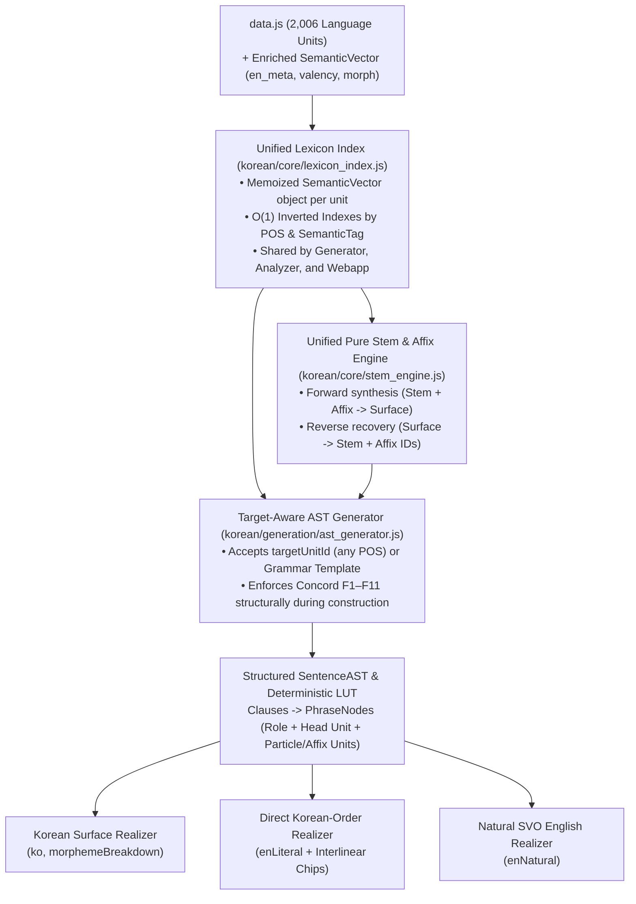

# Kongbuhey Architecture Audit & Dual English Translation Design

> **Status**: Proposal / Pre-Implementation Specification  
> **Scope**:  
> 1. **Dual English Translation Engine**: Direct Korean-Word-Order Translation (`enLiteral`) + Natural Idiomatic English Translation (`enNatural`) driven by language-unit metadata in `data.js`.  
> 2. **Engine & Webapp Architectural Refactoring**: Eliminating 4x duplicated morphology engines, unifying the split state/indexing systems, removing hardcoded magic IDs/Hangul tables, enabling target-unit-constrained sentence generation, and optimizing cold-start & runtime performance for iPhone/Android browsers.

---

## Part 1: Architectural Audit of the Existing Codebase

An inspection of `korean/`, `data.js`, and `webapp/` reveals that while the project has strong linguistic breadth (Features F1–F11 and a 7-stage text analyzer), the previous model introduced significant structural duplication, data-flow disconnects, and mobile performance bottlenecks.

### 1.1 Four Duplicated Korean Conjugation & Particle Engines
Currently, Korean stem conjugation and postpositional particle attachment are implemented **four separate times** across the codebase, each with different edge-case bugs:

1. **Engine A — [`korean/core/morphology.js`](file:///d:/Users/mvaga/Developer/agentic/antigravity/kongbuhey/korean/core/morphology.js) (1,739 lines)**:
   - Implements [`applyMorphology`](file:///d:/Users/mvaga/Developer/agentic/antigravity/kongbuhey/korean/core/morphology.js#L1682-L1705), [`attachParticle`](file:///d:/Users/mvaga/Developer/agentic/antigravity/kongbuhey/korean/core/morphology.js#L1401-L1445), [`conjugatePredicate`](file:///d:/Users/mvaga/Developer/agentic/antigravity/kongbuhey/korean/core/morphology.js#L698-L775), and [`buildActionVerbPhrase`](file:///d:/Users/mvaga/Developer/agentic/antigravity/kongbuhey/korean/core/morphology.js#L990-L1206).
   - Uses inline string tags like `가[regular]아요` or `춥[b_irregular]어요` resolved via multi-pass regular expressions.
   - **Performance/Architecture flaw**: Every call to [`applyMorphology(text)`](file:///d:/Users/mvaga/Developer/agentic/antigravity/kongbuhey/korean/core/morphology.js#L1682-L1705) unconditionally runs **five full-sentence regex concord repair passes** (`applyCounterConcord`, `applySpatialConcord`, `applyMoodConcord`, `applyAdverbConcord`, `applyClausalConcord`) even when simply conjugating a single word or validating a stem.
2. **Engine B — [`korean/state.js`](file:///d:/Users/mvaga/Developer/agentic/antigravity/kongbuhey/korean/state.js#L148-L230) (`basicConjugate`)**:
   - A 82-line copy-pasted mini-conjugator written *"to avoid circular dependency with full morphology"*.
   - **Bug**: Line 154 strips all irregularity markers (`let cleanStem = resolved.replace(/\[[^\]]+\]/g, '')`), causing `basicConjugate` to conjugate irregular verbs (`ㅂ`, `ㄷ`, `ㅅ`, `르`, `ㅎ`) as if they were regular!
3. **Engine C — [`korean/analyzer/indexer.js`](file:///d:/Users/mvaga/Developer/agentic/antigravity/kongbuhey/korean/analyzer/indexer.js#L31-L77) & [`korean/analyzer/verb_morphology.js`](file:///d:/Users/mvaga/Developer/agentic/antigravity/kongbuhey/korean/analyzer/verb_morphology.js) (696 lines)**:
   - [`deriveInformalConnectiveEndings`](file:///d:/Users/mvaga/Developer/agentic/antigravity/kongbuhey/korean/analyzer/indexer.js#L31-L77) and [`conjugateStemAo`](file:///d:/Users/mvaga/Developer/agentic/antigravity/kongbuhey/korean/analyzer/verb_morphology.js#L298-L355) re-implement vowel harmony (`ㅏ/ㅗ` vs `ㅓ`) and irregular stem allomorphy from scratch instead of sharing a single pure-function stem-allomorph table with `korean/core/`.
4. **Engine D — [`webapp/selector.js`](file:///d:/Users/mvaga/Developer/agentic/antigravity/kongbuhey/webapp/selector.js#L244-L405)**:
   - Re-implements `_conjugateAoStem`, `_conjugatePolite`, `_conjugatePastPolite`, `_conjugateFuturePolite`, and `_attachParticle` because `korean.js` lacked a browser bundle and could not generate sentences targeting a specific `unitId`.

### 1.2 Hardcoded Linguistic Logic & Magic Unit IDs (Violating Single Point of Truth)
Instead of storing morphological and syntactic properties in `data.js` (`SemanticVector`), several modules hardcode unit IDs and Hangul strings directly in JavaScript:

- **[`korean/analyzer/particles.js`](file:///d:/Users/mvaga/Developer/agentic/antigravity/kongbuhey/korean/analyzer/particles.js#L9-L73) (`PARTICLE_SPECS`)**: Hardcodes 55 particle definitions with raw numeric IDs (`ids: [199, 36]`, `ids: [1240, 1241, 1242]`, `batchimReq: false`), duplicating [`PARTICLE_PAIRS`](file:///d:/Users/mvaga/Developer/agentic/antigravity/kongbuhey/korean/state.js#L29-L41) in `state.js` and `attachParticle` in `morphology.js`.
- **[`korean/analyzer/verb_suffix_rules.js`](file:///d:/Users/mvaga/Developer/agentic/antigravity/kongbuhey/korean/analyzer/verb_suffix_rules.js#L1-L434) (`VERB_SUFFIX_RULES`)**: 434 lines of hardcoded surface suffix combinations with raw unit IDs (`id: 678`, `id: 335`, `id: 49`) and even hardcoded dictionary verbs (`fixed_base: '도와주다'`, `'이야기하다'`, `'어렵다'`) to patch around edge cases in compositional suffix stripping.
- **[`korean/analyzer/token_analyzer.js`](file:///d:/Users/mvaga/Developer/agentic/antigravity/kongbuhey/korean/analyzer/token_analyzer.js)**: Sprinkles magic IDs throughout parsing logic (`unitById.get(581)` for `것`, `56` for `이다`, `37` for `이에요/예요`, `1833` for `이야/야`, `335` for `-았/었-`, `644`/`645`/`646` for adnominal endings, `550` for `들`, `251` for `안`).
- **[`korean/specs/verb_argument_specs.js`](file:///d:/Users/mvaga/Developer/agentic/antigravity/kongbuhey/korean/specs/verb_argument_specs.js#L18-L132) (`ACTION_VERB_SPECS`, `DESCRIPTIVE_VERB_SPECS`)**: Hardcodes 65 Korean verb stems (`'가'`, `'먹'`, `'읽'`, `'마시'`, `'주'`, `'보내'`, etc.) and their required case frames/object tags in a standalone JS file instead of reading `valency` / `case_frame` from each verb's `SemanticVector` in `data.js`. Only 65 verbs get rich argument structures while the remaining ~350 verbs in `data.js` fall back to generic defaults!

### 1.3 Mobile Performance & Memory Bottlenecks (iPhone / Android)
For a mobile web app, startup time (Time-to-Interactive), memory footprint, and GC pause minimization are critical. Currently:

1. **Unmemoized `JSON.parse()` in Hot Loops**:
   - [`parseSemanticVector(unit)`](file:///d:/Users/mvaga/Developer/agentic/antigravity/kongbuhey/korean/core/primitives.js#L53-L59) runs `JSON.parse(unit[DATA_SCHEMA.SemanticVector])` on **every invocation** without caching the parsed object.
   - During `initAllDataSets()`, `getFilteredWords()`, and `generateSemanticSentence()`, `parseSemanticVector` is called **tens of thousands of times**, allocating and discarding temporary objects on every call.
2. **Linear Full-Dataset Scans on Every Slot Expansion**:
   - [`getFilteredWords(pos, tagFilter)`](file:///d:/Users/mvaga/Developer/agentic/antigravity/kongbuhey/korean/core/morphology.js#L1218-L1254) iterates over all 2,006 entries in `KR_EN_languageUnits`, calling `hasTag()` and `parseSemanticVector()` on each call. Expanding a single template with 4 slots performs 4–8 full scans of `data.js`.
3. **5,000+ Eager Regex Conjugations at Startup**:
   - [`initSemanticSets()`](file:///d:/Users/mvaga/Developer/agentic/antigravity/kongbuhey/korean/state.js#L655-L715) loops over every Descriptive Verb and calls `morph()` **18 times per verb** to populate `DESCRIPTIVE_SURFACE_MAP`, `FORBIDDEN_DV_PLAIN_PRES_FORMS`, `FORBIDDEN_DV_IMPERATIVE_FORMS`, and `FORBIDDEN_DV_PROPOSITIVE_FORMS`. Because `morph()` invokes `applyMorphology()` (and its 5 concord repair passes!), cold startup performs thousands of heavy regex replacements before a single sentence is even requested.
4. **Two Redundant State/Index Passes Over `data.js`**:
   - [`korean/state.js`](file:///d:/Users/mvaga/Developer/agentic/antigravity/kongbuhey/korean/state.js) (`initAllDataSets`) and [`korean/analyzer/indexer.js`](file:///d:/Users/mvaga/Developer/agentic/antigravity/kongbuhey/korean/analyzer/indexer.js) (`getIndex`) independently scan `KR_EN_languageUnits` and build overlapping lookup maps (`GRAMMAR_MAP` vs `grammarByKo`, `PROPER_NAMES` vs `vocabByKo`, `MOTION_VERBS` vs `motionVerbStems`).

### 1.4 Lossy Sentence Generation Pipeline (Why Translation & Reconstruction Fail)
Currently, sentence generation is split between [`template_engine.js`](file:///d:/Users/mvaga/Developer/agentic/antigravity/kongbuhey/korean/generation/template_engine.js) and [`semantic_generator.js`](file:///d:/Users/mvaga/Developer/agentic/antigravity/kongbuhey/korean/generation/semantic_generator.js):
- When [`buildActionVerbPhrase(verb, stem, noun)`](file:///d:/Users/mvaga/Developer/agentic/antigravity/kongbuhey/korean/core/morphology.js#L990-L1206) builds a verb phrase (e.g., `도서관에서 책을 읽다`), it returns a **flat string** (`"도서관에서 책을 읽[regular]"`), throwing away:
  - Which noun was the **Subject**, **Direct Object**, **Location**, **Recipient**, or **Instrument**;
  - Which **Particle language unit** (`에` #39, `에서` #112, `을/를` #36/#199, `와/과` #114) was attached to each noun;
  - Which **Tense / Honorific / Mood / Politeness** morphemes were attached to the predicate.
- Because the Language Unit Tree (`LUT`) in [`lut_serializer.js`](file:///d:/Users/mvaga/Developer/agentic/antigravity/kongbuhey/korean/utils/lut_serializer.js) only stores `[grammarId, verbId, nounId]`, calling [`reconstructFromLanguageUnitTree(lut)`](file:///d:/Users/mvaga/Developer/agentic/antigravity/kongbuhey/korean/utils/lut_serializer.js#L58-L130) re-runs random particle selection and cannot deterministically reconstruct either the exact Korean sentence or its English translations!
- Furthermore, [`generateSemanticSentence`](file:///d:/Users/mvaga/Developer/agentic/antigravity/kongbuhey/korean/generation/semantic_generator.js#L351-L435) only picks a random Grammar template first and fills slots randomly; it has **no API to generate a sentence guaranteed to feature a specific target `unitId`** (whether a Noun, Action Verb, Descriptive Verb, Adverb, Determiner, Counter, Particle, or Ending).

---

## Part 2: Unified Architecture & Target-Aware Sentence AST

To support **both** Direct Korean-Word-Order English (`enLiteral`) and Natural English (`enNatural`), while fixing the architectural flaws above, we introduce a **Morpheme- & Role-Aware Sentence AST (`SentenceAST`)** backed by a single unified Lexicon & Morphology Engine.



### 2.1 The `SentenceAST` Data Structure
Instead of concatenating raw strings early, sentence generation produces a structured `SentenceAST` where every token in the Korean sentence is represented by a **`PhraseNode`** (an *Eojeol* / spacing word unit) composed of explicit `LanguageUnit` references:

```js
/**
 * A single Korean spacing-word constituent (Eojeol) in exact Korean sentence order.
 */
interface PhraseNode {
  role: 'TOPIC' | 'SUBJECT' | 'OBJECT' | 'COMPLEMENT'
      | 'LOC_STATIC' | 'LOC_GOAL' | 'LOC_SOURCE' | 'DATIVE' | 'INSTRUMENT' | 'COMITATIVE'
      | 'TIME' | 'ADVERB' | 'DETERMINER' | 'ADNOMINAL_CLAUSE' | 'COUNTER_PHRASE'
      | 'PREDICATE' | 'AUXILIARY' | 'CONNECTIVE_PREDICATE' | 'INTERJECTION';
  
  // Ordered list of morphemes within this word (Root/Stem first, followed by suffixes/particles)
  morphemes: Array<{
    unitId: number;          // Exact ID in data.js (e.g. 265 '학생', 35 '은', 335 '-았/었-')
    kind: 'ROOT' | 'HONORIFIC' | 'TENSE' | 'MODALITY' | 'CONNECTIVE' | 'ENDING' | 'PARTICLE' | 'COPULA';
    koSurface: string;       // Realized Hangul slice (e.g. '학생', '은' or '공부했', '어요')
    enLiteralGloss: string;  // Direct Korean-order gloss (e.g. 'student', '[topic]', 'study', '-past', '-polite')
  }>;

  // Optional left-branching modifier (e.g., relative clause or descriptive verb modifying a head noun)
  modifiers?: PhraseNode[];

  // Syntactic & semantic features used by both Concord Validators (F1-F11) and English Realizers
  features: {
    person?: 1 | 2 | 3;
    number?: 'sg' | 'pl';
    honorific?: boolean;
    tense?: 'past' | 'present' | 'future';
    polarity?: 'positive' | 'negative_an' | 'negative_mot';
    mood?: 'declarative' | 'interrogative' | 'imperative' | 'propositive';
    formality?: 'formal' | 'polite' | 'casual' | 'plain';
    clauseConnectiveId?: number; // If this node ends Clause 1
  };

  koText: string;            // Joined Korean word (e.g. "도서관에서")
  enLiteralText: string;     // Korean-word-order English unit (e.g. "library-at")
}

interface ClauseNode {
  phrases: PhraseNode[];     // Ordered in exact Korean SOV order!
  connectiveUnitId?: number; // Connective linking this clause to the next (e.g. -(으)니까, -고, -지만)
}

interface SentenceAST {
  targetUnitId: number | null;
  grammarUnitId: number;
  clauses: ClauseNode[];     // 1 clause (simplex) or 2+ clauses (complex)
  ko: string;                // "학생은 오늘 도서관에서 한국어를 열심히 공부했어요."
  enLiteral: string;         // "Student-[topic] today library-at Korean-[obj] diligently studied."
  enMorphemic: string;       // "student-TOPIC · today · library-at · Korean-OBJ · diligently · study-PAST-POLITE"
  enNatural: string;         // "The student diligently studied Korean at the library today."
  lut: Array<any>;           // Lossless, deterministic Language Unit Tree
}
```

---

## Part 3: Dual English Translation System Design

### 3.1 Priority 1: Direct Korean-Word-Order Translation (`enLiteral`)
The primary pedagogical goal is to train English speakers to **think in Korean constituent and morpheme order**:
- **SOV Clause Order**: Topic/Subject $\rightarrow$ Time $\rightarrow$ Place $\rightarrow$ Manner Adverb $\rightarrow$ Indirect Object $\rightarrow$ Direct Object $\rightarrow$ Verb Stem + Honorific + Tense + Modality + Ending.
- **Postpositional Case & Role Markers**: In English, prepositions come *before* the noun (`"at the library"`, `"with a friend"`), and subject/object roles are determined solely by position. In Korean, particles attach *after* the noun (`도서관에서`, `친구와`, `책을`). In `enLiteral`, postpositions stay attached to the **right** of the noun (`"library-at"`, `"friend-with"`, `"book-[obj]"`).
- **Left-Branching Modifiers (Adnominal Clauses)**: One of the hardest shifts for English speakers is that Korean puts relative clauses *before* the noun (`[어제 제가 읽은] 책` = `[yesterday I-[subj] read-past] book`), whereas English puts them after (`"the book [that I read yesterday]"`). `enLiteral` preserves the exact Korean left-branching order so learners immediately see how the modifier clause precedes the head noun.
- **Noun + Number + Counter Order**: Korean expresses quantities as `Noun + Number + Counter` (`책 세 권` or `커피 두 잔`). `enLiteral` renders `"book three-volume(권)"` / `"coffee two-cup(잔)"` while `enNatural` renders `"three books"` / `"two cups of coffee"`.
- **Subordinate Clause First**: In Korean, subordinate clauses *always* precede the main clause (`비가 와서 집에 있었어요` = `"Rain-[subj] come-because, home-at stayed"`), even when natural English often puts `"because"` second (`"I stayed home because it rained"`).

#### Concrete Side-by-Side Comparison Across Grammar Types

| Grammatical Pattern | Korean Sentence (`ko`) | 1. Direct Korean-Word-Order (`enLiteral`) *(Primary Priority)* | 2. Natural Idiomatic English (`enNatural`) *(Secondary Priority)* |
| :--- | :--- | :--- | :--- |
| **Basic SOV + Locative + Object** | `학생은 오늘 도서관에서 한국어를 열심히 공부했어요.` | `Student-[topic] today library-at Korean-[obj] diligently study-past.` | `The student diligently studied Korean at the library today.` |
| **Directional Motion + Purpose (`-(으)러`)** | `저는 친구를 만나러 카페에 가요.` | `I-[topic] friend-[obj] meet-in-order-to cafe-to go.` | `I am going to the cafe to meet a friend.` |
| **Causal Connective (`-아서/어서`)** | `날씨가 추워서 따뜻한 차를 마셨어요.` | `Weather-[subj] cold-because, warm tea-[obj] drink-past.` | `Because the weather was cold, I drank warm tea.` |
| **Left-Branching Relative Clause (`-(으)ㄴ`)** | `제가 어제 산 가방은 아주 가벼워요.` | `[I-[subj] yesterday buy-past] bag-[topic] very light-is.` | `The bag that I bought yesterday is very light.` |
| **Noun + Numeral + Counter (`F6`)** | `언니가 사과 다섯 개를 샀어요.` | `Older-sister-[subj] apple five-unit(개)-[obj] buy-past.` | `My older sister bought five apples.` |
| **Desiderative + Negation (`-고 싶다` / `못`)** | `내일은 일찍 일어나고 싶지 않아요.` | `Tomorrow-[topic] early wake-up-want-to not-do.` | `Tomorrow, I do not want to wake up early.` |
| **Honorific Subject & Suppletion (`F5`)** | `할머니께서 진지를 잡수셨어요.` | `Grandmother-[subj-hon] meal(hon)-[obj] eat(hon)-hon-past.` | `Grandmother had her meal.` |
| **Experiential / Ability (`-(으)ㄴ 적이 있다`)** | `저는 한국 영화를 본 적이 있어요.` | `I-[topic] Korean movie-[obj] see-past experience-[subj] exist.` | `I have seen a Korean movie before.` |

#### Interactive Word-by-Word Alignment in the Webapp UI
Because `SentenceAST.clauses[].phrases` maps 1-to-1 with the space-separated Korean words (Eojeol), the UI can render each Korean word and its `enLiteral` gloss as **aligned interlinear chips** (or toggle between compact sentence view and aligned chip view on tap):

```
[학생은]          [오늘]     [도서관에서]    [한국어를]       [열심히]       [공부했어요.]
Student-[topic]   today      library-at     Korean-[obj]    diligently     study-past-polite.
```

---

### 3.2 Priority 2: Natural Idiomatic English Realizer (`enNatural`)
Because `SentenceAST` already knows the syntactic role (`TOPIC`, `SUBJECT`, `OBJECT`, `LOC_STATIC`, `LOC_GOAL`, `TIME`, `ADVERB`, `PREDICATE`) and the grammatical features (`tense`, `mood`, `polarity`, `person`, `number`) of every constituent, generating **Natural SVO English** requires **no machine translation model and no fragile regexes**—just a deterministic **Clause-to-SVO Realizer** (~220 lines):

1. **Clause Constituent Reordering (SOV $\rightarrow$ SVO)**:
   - Extracts constituents from each `ClauseNode` by role and orders them as:
     `[Discourse/Topic-Time] + [Subject] + [Aux/Modal/Negation] + [Main Verb] + [Indirect Object] + [Direct Object / Complement] + [Manner Adverb] + [Direction/Location PP] + [Time]`.
2. **Pro-Drop Subject Resolution**:
   - Korean frequently omits subjects (`카페에 가요`). When a `ClauseNode` has no explicit `SUBJECT` or `TOPIC` phrase, the English realizer supplies the default pronoun based on `mood`:
     - Declarative: `"I"` (or `"It"` for weather/time predicates like `비가 오다`, `춥다`, `늦다`).
     - Interrogative: `"you"` (`어디에 가요?` $\rightarrow$ `"Where are you going?"`).
     - Imperative: omitted (`조심하세요` $\rightarrow$ `"Please be careful."`).
     - Propositive: `"let's"` (`같이 가요` $\rightarrow$ `"Let's go together."`).
3. **English Verb & Copula Inflection**:
   - Strips `"to "` / `"to be "` from `English` definitions once at index time.
   - Uses a compact 35-line English morphology helper + irregular verb overrides in `SemanticVector.en_verb` (`eat/ate/eaten`, `go/went/gone`, `buy/bought`, `drink/drank/drunk`, `read/read`, `see/saw/seen`, etc.) to inflect the verb for:
     - **Past**: `"ate"`, `"went"`, `"studied"`, `"was/were delicious"`, `"did not eat"`.
     - **Present**: `"eat/eats"` (or progressive `"am/is/are eating"` for active motion/action verbs in present polite), `"is/are delicious"`.
     - **Future / Intentional**: `"will eat"` / `"am/is/are going to eat"`.
     - **Modality**: `"want(s) to V"`, `"can/cannot V"`, `"must / have to V"`, `"try to V"`, `"plan to V"`.
4. **English Determiner & Preposition Selection**:
   - Countable singular common nouns without a determiner (`책`, `친구`, `카페`) receive `"a"`/`"an"` or `"the"` based on role (`TOPIC` $\rightarrow$ `"the"`, `OBJECT` $\rightarrow$ `"a/an"` or plural, `kinship` $\rightarrow$ `"my"`). Uncountable (`물`, `날씨`, `음악`), proper (`한국`, `서울`, `민수`), and temporal nouns (`오늘`, `내일`, `지금`) take no article.
   - Postpositions map to natural prepositions (`에서` $\rightarrow$ `"at"` / `"in"` / `"from"`, `에` $\rightarrow$ `"to"` / `"at"` / `"on"` / `"in"` depending on whether the head noun is `place`, `time`, or `direction`).

---

### 3.3 Metadata Schema Additions to `data.js` (`SemanticVector`)
Right now, `data.js` has 2,006 language units, each with a `SemanticVector` JSON column (`index 7`). However, the `English` column (`index 2`) contains raw dictionary strings like:
- `"student, pupil"`, `"to eat, consume"`, `"to be delicious, tasty"`, `"Subject marker (after consonant)"`, `"Polite informal ending (after ㅏ/ㅗ)"`.

Instead of parsing those dictionary strings with ad-hoc regexes in UI code, we enrich `SemanticVector` in `data.js` via a deterministic build/migration script (`scripts/enrich_language_metadata.js`) with compact, human-editable metadata keys:

#### 1. For Nouns, Pronouns, Numbers, Counters, Adverbs (`en`)
```json
{
  "act": 0.1,
  "tags": ["person", "social", "academics"],
  "en": {
    "lit": "student",
    "nat": "student",
    "count": "c"
  }
}
```
- `en.lit`: Concise 1-to-2 word gloss for `enLiteral` (`"student"`, `"older-sister"`, `"library"`).
- `en.nat`: Primary English noun (`"student"`, `"older sister"`, `"library"`).
- `en.count`: `"c"` (countable: takes `a/an/the`), `"u"` (uncountable: `water`, `music`), `"p"` (proper/pronoun: no article), `"k"` (kinship: defaults to `"my ..."` when unmodified in natural English).
- `en.pl`: Only present if irregular in English (`"children"`, `"people"`, `"feet"`, `"teeth"`).

#### 2. For Action Verbs & Descriptive Verbs (`en` + `valency`)
Moving `ACTION_VERB_SPECS` and `DESCRIPTIVE_VERB_SPECS` out of hardcoded JS (`korean/specs/verb_argument_specs.js`) and directly into `SemanticVector` in `data.js`:
```json
{
  "act": 0.85,
  "tags": ["food", "daily_life"],
  "valency": {
    "role": "OBJECT",
    "particle": "을/를",
    "objTags": ["food", "edible"]
  },
  "en": {
    "lit": "eat",
    "base": "eat",
    "past": "ate",
    "part": "eaten"
  }
}
```
For Descriptive Verbs (e.g. `맛있다` #148):
```json
{
  "act": 0.3,
  "tags": ["food", "taste", "positive"],
  "valency": {
    "subjTags": ["food", "edible", "beverage"]
  },
  "en": {
    "lit": "delicious-be",
    "adj": "delicious",
    "copula": true
  }
}
```
> **Note**: Regular English verbs (`study`, `walk`, `clean`, `open`, `cook`, `watch`, `listen`) only need `"base": "study"`—our 30-line English inflector derives `studies`, `studied`, `studying` automatically. Only the ~58 irregular English verbs in `data.js` store explicit `"past"` / `"part"` keys.

#### 3. For Particles, Endings, & Grammar Patterns (`en` + `morph`)
Every Particle and Grammar unit in `data.js` gets explicit Korean-order literal glosses (`en.lit`) and natural realization descriptors (`en.nat`):
- **Particles**:
  - `은/는` (#35, #198): `"en": { "lit": "[topic]", "role": "TOPIC" }`
  - `이/가` (#34, #197): `"en": { "lit": "[subj]", "role": "SUBJECT" }`
  - `을/를` (#36, #199): `"en": { "lit": "[obj]", "role": "OBJECT" }`
  - `에서` (#112): `"en": { "lit": "-at/from", "prep": "at", "sourcePrep": "from", "role": "LOC_STATIC" }`
  - `에` (#39): `"en": { "lit": "-to/at", "goalPrep": "to", "locPrep": "at", "timePrep": "at" }`
  - `(으)로` (#113): `"en": { "lit": "-by/toward", "instPrep": "by", "dirPrep": "toward" }`
  - `와/과`, `하고`, `(이)랑`: `"en": { "lit": "-with", "prep": "with", "role": "COMITATIVE" }`
- **Connectives & Endings**:
  - `-아서/어서` (#53): `"en": { "lit": "-because/so", "frame": "Because {C1}, {C2}" }`
  - `-(으)니까` (#54): `"en": { "lit": "-since", "frame": "Since {C1}, {C2}" }`
  - `-지만` (#51): `"en": { "lit": "-but", "frame": "{C1}, but {C2}" }`
  - `-(으)면` (#52): `"en": { "lit": "-if/when", "frame": "If {C1}, {C2}" }`
  - `-(으)러` (#120): `"en": { "lit": "-in-order-to", "frame": "{C2} in order to {C1_inf}" }`
  - `-고 싶다` (#46): `"en": { "lit": "-want-to", "modal": "want to" }`
  - `-(으)ㄹ 수 있다` (#49): `"en": { "lit": "-can", "modal": "can" }`
  - `-았/었-` (#335): `"en": { "lit": "-past", "tense": "past" }`
  - `-(으)ㄹ 것이다` (#47): `"en": { "lit": "-will", "tense": "future" }`

---

## Part 4: Engineering & Performance Refactoring Plan

### 4.1 Consolidating the 4 Morphology Engines into `korean/core/stem_engine.js`
We extract a single, zero-dependency, pure-function **Stem & Allomorph Engine** (`korean/core/stem_engine.js`, < 280 lines) that handles all 8 Korean verb classes (`regular`, `ㅂ` irregular, `ㄷ` irregular, `ㅅ` irregular, `르` irregular, `ㅡ` dropout, `ㄹ` dropout, `ㅎ` irregular, plus `이다`/`아니다` and `하다` $\rightarrow$ `해`):
- **Forward API**:
  - `realizeStemWithEnding(stem, conjClass, endingPattern)` $\rightarrow$ returns `{ surface, stemSurface, endingSurface }` (giving us exact morpheme boundaries for interlinear glossing!).
  - `selectParticleVariant(nounSurface, particlePairSpec)` $\rightarrow$ handles batchim and `ㄹ`-batchim (`(으)로`).
- **Consumers**:
  1. `korean/core/morphology.js` delegates stem + affix joining to `stem_engine.js`.
  2. `korean/state.js` deletes `basicConjugate` (82 lines) and calls `stem_engine.realizeStemWithEnding` directly—fixing the bug where `state.js` ignored irregular verbs!
  3. `korean/analyzer/indexer.js` and `verb_morphology.js` share the exact same irregular stem allomorph rules.
  4. `webapp/selector.js` deletes its 160-line duplicate conjugator and calls the shared engine directly.

### 4.2 Unifying the Lexicon Index & Cutting Mobile Startup Time by ~80%
We introduce a unified, singleton **Lexicon & Semantic Index** (`korean/core/lexicon_index.js`) shared by both the Generator (`state.js`) and the Analyzer (`analyzer/indexer.js`):

1. **Memoized `parseSemanticVector(unit)`**:
   - Uses a `WeakMap` (or symbol property `unit[SV_CACHE_SYMBOL]`) so `JSON.parse()` runs **at most once per unit** across the entire lifetime of the app. When a user edits `SemanticVector` in the Spreadsheet UI, the cache entry for that `unit` is invalidated immediately.
2. **Pre-Computed Inverted Tag & POS Indexes ($O(1)$ Slot Lookup)**:
   - At index initialization, a single pass (~3ms on mobile) builds:
     - `unitsById: Map<number, Unit>`
     - `unitsByPos: Map<string, Unit[]>`
     - `unitsByTag: Map<string, Set<number>>`
   - `getFilteredWords(pos, tagFilter)` is upgraded from an $O(N)$ full-dataset scan + `JSON.parse()` loop to an $O(1)$ tag-set intersection, making template slot expansion **15x–30x faster** on mobile CPUs.
3. **Lazy / Rule-Based Concord Validation Instead of 5,000+ Startup Regex Conjugations**:
   - Instead of calling `morph()` 18 times on every Descriptive Verb at startup to populate `FORBIDDEN_DV_IMPERATIVE_FORMS` etc., `DESCRIPTIVE_SURFACE_MAP` is built lazily or via fast stem-allomorph generation (`stem_engine.realizeStemWithEnding`) without running the 5 full-sentence concord repair regex passes during initialization.

### 4.3 Target-Unit-Constrained Sentence Generation (`generateSentencesForUnit(unitId, count)`)
Currently, `generateSemanticSentence()` in [`korean/generation/semantic_generator.js`](file:///d:/Users/mvaga/Developer/agentic/antigravity/kongbuhey/korean/generation/semantic_generator.js#L351-L435) only starts from a random Grammar template and cannot target a specific vocabulary or grammar unit.
We will add a first-class **`generateSentenceForUnit(unitId, options)`** API to `korean/generation/`:
- **If `unit` is a Grammar / Ending / Connective / Particle unit**:
  - Uses that unit's syntax template (`SyntaxFrame` / `SemanticVector`) directly and fills its argument slots with semantically concordant vocabulary (enforcing F1–F11).
- **If `unit` is an Action Verb or Descriptive Verb**:
  - Reads the verb's `valency` (from `SemanticVector`, e.g., required object/location tags, honorific subject constraints, agentivity) and selects compatible simplex and complex grammar templates (`-아요/어요`, `-았/었어요`, `-(으)ㄹ 거예요`, `-고 싶어요`, `-아서/어서`, `-(으)니까`, `-(으)면`), pinning the target verb as the clause predicate.
- **If `unit` is a Noun / Pronoun**:
  - Inspects the noun's semantic tags (`food`, `place`, `person`, `time`, `vehicle`, `clothing`, `weather`, `abstract`, etc.) and selects verbs whose `valency.objTags`, `valency.locTags`, or `valency.subjTags` match the noun, pinning the target noun into the matching slot!
- **If `unit` is an Adverb / Determiner / Number / Counter**:
  - Respects F6 (Counter Concord: matches the counter with a compatible noun and native/sino numeral), F8/F9 (Adverbial & NPI Concord: pairs `별로`/`전혀` with negative predicates, `어제` with past tense, `내일` with future tense, degree adverbs with descriptive verbs).

Every generated sentence returns the full `SentenceAST`:
- `ko`: Impeccable Korean sentence verified against all 11 concord validators (F1–F11).
- `enLiteral`: Direct Korean-word-order English translation.
- `enMorphemic`: Morpheme-by-morpheme breakdown (`PhraseNode[]`) for aligned word chips.
- `enNatural`: Natural SVO English translation.
- `lut`: Lossless Language Unit Tree.

### 4.4 Webapp UI Integration (Unit Details & Mobile-First Ergonomics)
In [`webapp/selector.js`](file:///d:/Users/mvaga/Developer/agentic/antigravity/kongbuhey/webapp/selector.js) (the Language Unit Details view):
1. Each of the 3 generated example cards will display:
   - **Korean Sentence** (with the target unit highlighted, and optional tap-to-inspect word alignment chips).
   - **Primary Translation — Direct Korean Word Order (`KO-Order`)**: Prominent, styled with a distinct badge (`KO-ORDER`) showing the exact Korean constituent/morpheme ordering so the learner immediately grasps the Korean structure.
   - **Secondary Translation — Natural English (`Natural`)**: Displayed cleanly underneath in muted secondary typography for quick comprehension check.
2. A global or per-card toggle (`[Word-by-Word Chips]`) lets the user see the Korean words stacked directly above their English literal glosses, wrapping cleanly on narrow iPhone/Android viewports (`320px–430px` width).

---

## Part 5: Phased Implementation Roadmap

To keep every change verifiable and safe, we will execute this in 5 modular phases:

1. **Phase 1 — Metadata Enrichment in `data.js`**:
   - Create `scripts/enrich_language_metadata.js` to populate `en` (clean literal/natural glosses, irregular English verb forms, particle/ending literal & natural frames) and `valency` (verb argument specs) in `SemanticVector` across all 2,006 language units in `data.js`.
2. **Phase 2 — Unified Lexicon Index & Stem Engine (`korean/core/`)**:
   - Implement memoized `parseSemanticVector` and $O(1)$ inverted POS/Tag indexes in `korean/core/lexicon_index.js`.
   - Extract `korean/core/stem_engine.js` and replace `basicConjugate` in `korean/state.js` and duplicate stem conjugators.
   - Eliminate startup regex bottlenecks in `initSemanticSets()`.
3. **Phase 3 — `SentenceAST`, Target-Unit Generator & Lossless LUT (`korean/generation/`)**:
   - Upgrade sentence generation to produce structured `SentenceAST` (`ClauseNode` $\rightarrow$ `PhraseNode` with explicit roles and morpheme unit IDs).
   - Implement `generateSentenceForUnit(unitId, options)` supporting all parts of speech and enforcing F1–F11 concord rules.
4. **Phase 4 — Dual English Realizers (`korean/translation/`)**:
   - Build `korean/translation/literal_realizer.js` (Direct Korean-Word-Order translation + interlinear word chips).
   - Build `korean/translation/natural_realizer.js` (Clause-to-SVO natural English realizer with English verb inflection and article/preposition selection).
5. **Phase 5 — Webapp Integration & Verification (`webapp/` & `test/`)**:
   - Bundle/expose the unified engine to `webapp/index.html` and `webapp/selector.js`, removing the ad-hoc generator in `selector.js`.
   - Render both **Korean-Order Literal** (primary) and **Natural English** (secondary) translations + interactive word-order alignment chips in the Language Unit Details view.
   - Run full regression suites (`node test.js`, `node test/spreadsheet_ui_test.js`, plus new unit tests for `enLiteral`, `enNatural`, target-unit generation across all POS, and mobile startup benchmarks).

