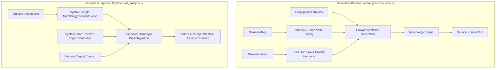

# Kongbuhey Architecture & Data Schema Specification

This document provides the canonical design documentation for the Kongbuhey data architecture, column definitions, and the dual-pipeline design.

---

## 1. Dual-Pipeline Architecture

Kongbuhey operates two complementary linguistic pipelines:



- **Forward Generation (`korean.js`, `exhaustive.js`)**:
  - Uses `Conjugation` formulas (e.g. `["{VP_AVst}으/니까 {Clause}"]`) to recursively expand grammatical templates.
  - Uses `SemanticTags` to select compatible arguments (e.g. food objects with eating verbs).
  - Uses `SemanticVector` to enforce discourse logic and polarity matching (e.g. positive reason with positive outcome).
  - Strictly **does not** use `SyntaxFrame`.

- **Reverse Analysis & Ingestion (`text_analyzer.js`)**:
  - Takes natural Korean study texts and decomposes them using declarative suffix/particle tables sorted by syllable length.
  - Uses `SyntaxFrame` (reverse regex grammar patterns) to disambiguate homonyms and structural roles based on surrounding tokens.
  - Strictly **does not** use `Conjugation` expansion templates.

---

## 2. DATA_SCHEMA Column Definitions

Every row in `KR_EN_languageUnits` in [data.js](data.js) is an array formatted according to `DATA_SCHEMA`:

| Index | Column Name | Type | Description | Primary Consumer |
|---|---|---|---|---|
| 0 | `Id` | `number` | Unique sequential integer primary key (0..N). | All tooling |
| 1 | `Korean` | `string` | Surface form or dictionary lemma (with trailing `-다` for verbs/adjectives). | All tooling |
| 2 | `English` | `string` | English translation, contextual gloss, and explanation. | UI & Study texts |
| 3 | `PartofSpeech` | `string` | Canonical category: `"Noun"`, `"Action Verb"`, `"Descriptive Verb"`, `"Adverb"`, `"Grammar"`, `"Pronoun"`, `"Number"`, `"Exclamation"`, `"Determiner"`. | Filter & Cache engines |
| 4 | `SemanticTags` | `string[]` / `Set<string>` | Lexical classification & selectional restriction tags (e.g. `transitive_food`, `transitive_place`, `descriptive_person`). | `findNounForVerbTag` in `korean.js` |
| 5 | `Disambiguation` | `string` | Short human/LLM label to differentiate homonyms (e.g. `"snow vs eye"`, `"person/hour counter"`). | `homonyms.js` |
| 6 | `Conjugation` | `string` \| `string[]` | Conjugation rule identifier (verbs/adjectives) or forward template expansion formulas (Grammar units). | `korean.js`, `exhaustive.js` |
| 7 | `Source` | `string` | Curriculum origin tag (e.g. `SUOBI01`, `class2012`). | Curriculum filters |
| 8 | `PriorityScore` | `number` | TOPIK frequency/pedagogical tier (1 = core vocabulary, 5 = niche). | Learning order |
| 9 | `FormalityLevel` | `string` | Speech register: `"informal_low"`, `"polite"`, `"formal_high"`, etc. | Morphology engine |
| 10 | `HonorificRules` | `string` | Sociolinguistic honorific rules (e.g. replace with `말씀하시다` for respected subjects). | Honorific generation |
| 11 | `SemanticVector` | `string` (JSON) | Discourse semantics, causal state transitions, and sentiment harmony. | `expandSemanticVerb` in `korean.js` |
| 12 | `SyntaxFrame` | `string` | Regex reverse-grammar collocation template for parsing/reading text. | `text_analyzer.js` |

---

## 3. Deep-Dive: SemanticVector vs. SemanticTags vs. SyntaxFrame

### SemanticTags (Selectional Restrictions)
- **Role**: Determines *which nouns go with which verbs/adjectives*.
- **Mechanism**: Declaratively defined in `ACTION_VERB_SPECS` and `DESCRIPTIVE_VERB_SPECS` in [korean.js](korean.js).
- **Example**:
  - `사과` (apple) has tag `"food"`.
  - `먹다` (eat) has tag `"transitive_food"`.
  - When the generator expands `{VP_AVst}`, it matches `transitive_food` with a `food` noun, producing `사과를 먹다`.

### SemanticVector (Discourse Flow & Transitions)
- **Role**: Controls multi-clause coherence, cause-and-effect transitions, and sentiment consistency.
- **Active Schema**:
  - **For Grammar units**:
    ```json
    { "logic": "cause_effect" | "contrast" | "condition" | "parallel" | "declarative" }
    ```
  - **For Content words**:
    ```json
    {
      "domain": "food" | "motion" | "emotion" | "state" | "...",
      "polarity": -1 | 0 | 1,
      "req": "state_precondition",
      "prod": "state_produced",
      "TODO": "Explanatory note for future generator constraint logic"
    }
    ```
- **Engine Behavior in `korean.js`**:
  - **`cause_effect` (`-(으)니까`, `-아서/어서`)**: Enforces `verb.polarity === currentContext.polarity` (positive reason leads to positive outcome; negative problem leads to negative outcome).
  - **`contrast` (`-는데`, `-지만`)**: Enforces `verb.polarity !== currentContext.polarity` (positive premise leads to negative turn).
  - **`req` / `prod`**: Action chains (e.g. `req: "language"` -> `prod: "knowledge"`).
  - **`TODO`**: Annotates valuable semantic distinctions discovered during data audits to be promoted to generator logic.

### SyntaxFrame (Reading / Parsing Only)
- **Role**: Collocation regex pattern used exclusively when **reading** text in [text_analyzer.js](text_analyzer.js) to disambiguate homonyms and recognize grammatical particles.
- **Example**:
  - Differentiating the particle `-(으)로` (direction/instrumental) from homonym words.
  - Differentiating adnominal verb endings from clause connectives based on what follows them.
- **Strict Rule**: Never consulted during forward phrase generation.
