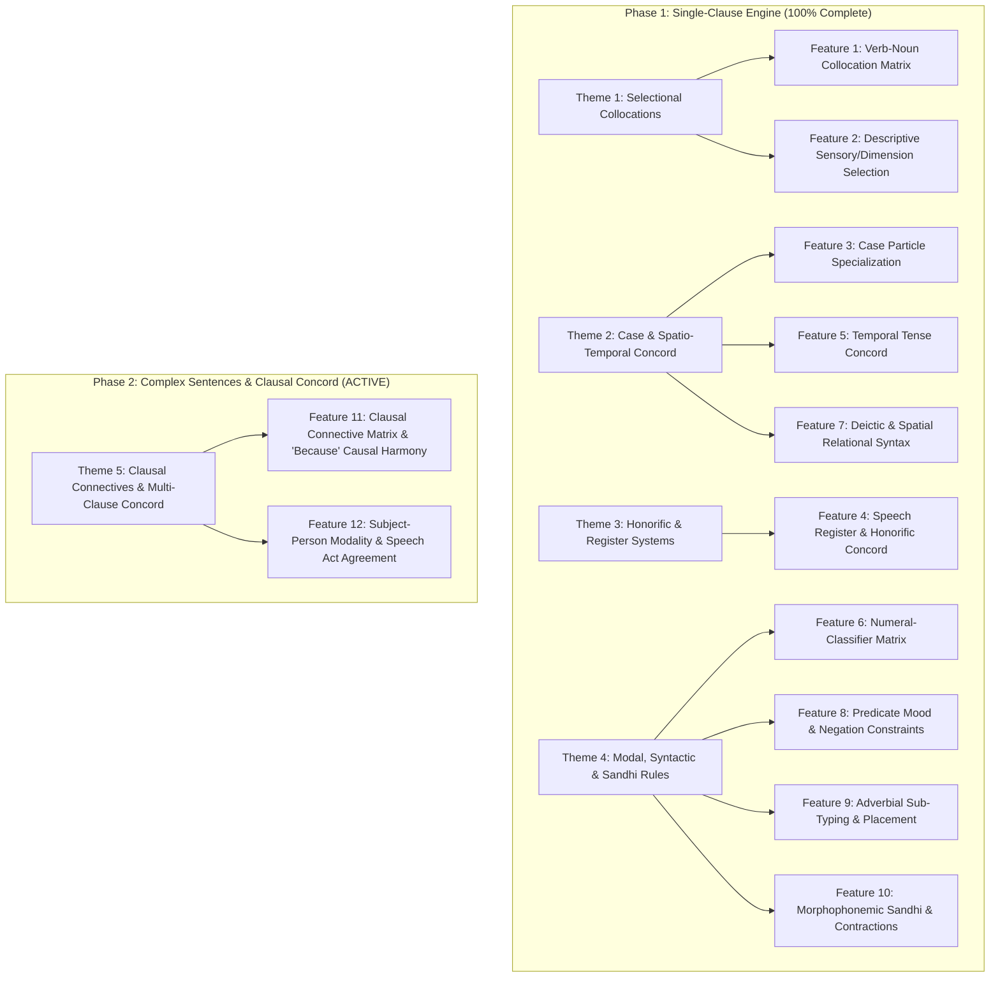

# Kongbuhey - Semantic Rules & Phrase Generation Roadmap

## 1. Executive Summary & Core Objective

The ultimate pedagogical value of Kongbuhey relies on **correct, natural random phrase generation** to provide authentic context for Korean grammar and vocabulary recognition.

Following the curriculum-wide audit of all units in [`data.js`](file:///d:/Users/mvaga/Developer/agentic/antigravity/kongbuhey/data.js), all 10 core architectural features (F1 through F10) in **Phase 1** have been **100% completed, tested, and validated (5,695 assertions passing)**. All temporary `TODO` strings have been successfully resolved and cleaned from `data.js`, reducing its file size by ~191 KB (~36%).

**Phase 2** expands Korean phrase generation from single-clause sentences into **compound multi-clause sentences, clausal connectives, and subject-person modality**.

---

## 2. Feature Specifications & Technical Design

### Theme 1: Selectional Collocations

#### Feature 1: Selectional Restriction & Verb-Noun Collocation Matrix
* **Units Collapsed**: **437 units** (Action Verbs and associated direct object nominals).
* **Linguistic Scope & Rules**:
  * **Apparel wear verbs**:
    * Body clothes (`입다`): `옷, 바지, 치마, 셔츠, 코트, 재킷, 티셔츠, 정장, 한복, 잠옷`
    * Footwear (`신다`): `신발, 구두, 운동화, 부츠, 슬리퍼, 양말`
    * Headwear / Eyewear (`쓰다`): `모자, 안경, 선글라스, 우산`
    * Gloves / Rings (`끼다`): `장갑, 반지, 렌즈`
    * Neck / Fasteners (`매다`): `넥타이, 스카프, 벨트, 배낭`
    * Wrist / Waist accessories (`차다`): `시계`
    * Universal apparel removal (`벗다`): applies across all apparel items.
  * **Intake & Consumption**:
    * Solids (`먹다, 씹다, 삼키다`): `음식, 밥, 사과, 빵, 고기, 라면`
    * Liquids (`마시다`): `물, 커피, 차, 주스, 우유, 술, 맥주`
    * Medicine (`약`): strictly `먹다` (never `*마시다` unless liquid medicine)
    * Tobacco (`담배`): strictly `피우다` (never `*먹다` or `*마시다`)
  * **Vehicles & Transportation**:
    * Boarding (`타다`): `버스, 지하철, 택시, 기차, 비행기, 자전거, 배`
    * Alighting (`내리다`): `[Transport]에서 내리다`
    * Transfer (`갈아타다`): `[Transport]을/를 / [Transport]로 갈아타다`
    * Driving (`운전하다`): `차, 자동차`
  * **Instruments & Sports**:
    * Struck/Plucked instruments (`치다`): `피아노, 기타`
    * Wind instruments (`불다`): `트럼펫, 플루트, 하모니카, 피리`
    * Bowed strings (`켜다`): `바이올린, 첼로`
    * Hand/Racket sports (`치다`): `테니스, 탁구, 골프, 배드민턴`
    * Team ball/martial sports (`하다`): `축구, 농구, 배구, 야구, 수영, 태권도`
  * **Habitual Activity Collocations**:
    * `영화를 보다`, `음악/수업을 듣다`, `사진을 찍다`, `전화를 걸다/받다`, `숙제를 하다`, `시험을 보다`, `돈을 내다/쓰다/벌다`, `이를 닦다`, `손을 씻다`, `빨래를 하다`.
* **Current Problem Solved**: Currently, verbs marked `transitive_general` randomly sample any noun, yielding absurd combinations like *“컴퓨터를 입습니다”* (wearing a computer) or *“구두를 먹어요”* (eating shoes).
* **Engine Integration**:
  * Expand `ACTION_VERB_SPECS` in [`korean.js`](file:///d:/Users/mvaga/Developer/agentic/antigravity/kongbuhey/korean.js) from 10 coarse tags to fine-grained semantic sub-specs (`transitive_clothing_body`, `transitive_footwear`, `transitive_headwear`, `transitive_liquid`, `transitive_instrument_strike`, `transitive_vehicle_ride`, etc.).
  * Ensure `findNounForVerbTag` selects matching nouns from `SemanticTags`.
* **Testing Infrastructure**:
  * **Existing Infra**: Insufficient. [`exhaustive.js`](file:///d:/Users/mvaga/Developer/agentic/antigravity/kongbuhey/exhaustive.js) only validates morphology and token syntax.
  * **New Script Needed**: Create `test/collocation_test.js` to assert that 100% of generated verb-object pairs conform to the selectional restriction matrix with 0 semantic mismatches.

---

#### Feature 2: Descriptive Verb Sensory, Dimensional & Affective Selection
* **Units Collapsed**: **165 units** (Descriptive Verbs and sensory/affective subjects).
* **Linguistic Scope & Rules**:
  * **Taste / Flavor**: `음식, 맛, 국, 찌개, 사과, 김치` $\leftrightarrow$ `달다, 쓰다, 맵다, 짜다, 싱겁다, 시다, 맛있다, 맛없다`.
  * **Weather / Atmosphere**: `날씨, 기온, 바람, 하늘, 공기` $\leftrightarrow$ `덥다, 춥다, 따뜻하다, 시원하다, 맑다, 흐리다, 쌀쌀하다`.
  * **Physical Dimension & Scale**:
    * Rooms/Streets: `방, 집, 길, 도로` $\leftrightarrow$ `넓다, 좁다`
    * Linear length: `치마, 바지, 머리, 줄, 시간` $\leftrightarrow$ `길다, 짧다`
    * Vertical height / Price: `산, 건물, 키, 가격` $\leftrightarrow$ `높다, 낮다`
    * Weight: `가방, 짐, 책` $\leftrightarrow$ `무겁다, 가볍다`
    * General scale: `그릇, 옷, 크기` $\leftrightarrow$ `크다, 작다`
  * **Psychological & Emotional State**: `기분, 마음` $\leftrightarrow$ `좋다, 나쁘다, 기쁘다, 슬프다, 상쾌하다, 불안하다`.
  * **Difficulty & Comprehension**: `한국어, 시험, 문제, 숙제` $\leftrightarrow$ `쉽다, 어렵다, 복잡하다`.
* **Current Problem Solved**: Eliminates semantically nonsensical pairings like *“날씨가 맵습니다”* (the weather is spicy) or *“사과가 친절해요”* (the apple is friendly).
* **Engine Integration**: Expand `DESCRIPTIVE_VERB_SPECS` in [`korean.js`](file:///d:/Users/mvaga/Developer/agentic/antigravity/kongbuhey/korean.js) to route `descriptive_taste`, `descriptive_weather`, `descriptive_dimension_spatial`, `descriptive_dimension_length`, `descriptive_emotion`, and `descriptive_difficulty` to compatible subject nouns.
* **Testing Infrastructure**:
  * **Existing Infra**: Insufficient.
  * **New Script Needed**: Include descriptive predicate assertions in `test/collocation_test.js`.

---

### Theme 2: Case & Spatio-Temporal Concord

#### Feature 3: Case Particle Semantic Specialization (-에 vs -에서, -에게 vs -에 vs -께, -(으)로)
* **Units Collapsed**: **297 units**.
* **Linguistic Scope & Rules**:
  1. **Locative Duality**:
     * Destination / Goal / Static existence takes **`-에`**: `학교에 가다/오다/다니다`, `방에 있다/살다/앉다`.
     * Dynamic activity site takes **`-에서`**: `식당에서 밥을 먹다`, `도서관에서 공부하다`.
     * Origin / Departure takes **`-에서`**: `미국에서 오다`, `버스에서 내리다`.
  2. **Dative Animacy & Respect**:
     * Animate humans/animals take **`-에게`** (formal/written) or **`-한테`** (spoken): `친구에게 주다`, `동생한테 전화하다`.
     * Inanimate institutions/locations take **`-에`**: `회사에 전화하다`, `은행에 돈을 보내다`, `학교에 문의하다`.
     * Respected elders take **`-께`**: `선생님께 드리다`, `부모님께 여쭈다`.
  3. **Instrumental `-(으)로`**:
     * Transportation: `버스로`, `지하철로`.
     * Tool: `연필로`, `젓가락으로`.
     * Language: `한국어로`.
* **Current Problem Solved**: Currently, [`attachParticle`](file:///d:/Users/mvaga/Developer/agentic/antigravity/kongbuhey/korean.js#L267-L273) always outputs `-에` for location and `-에게` for all datives regardless of animacy, producing ungrammatical phrases like *“식당에 밥을 먹다”* (eating food *to* a restaurant) or *“회사에게 전화하다”* (calling *to-person* a company).
* **Engine Integration**: Update `attachParticle(nounUnit, particleType, verbUnit)` in [`korean.js`](file:///d:/Users/mvaga/Developer/agentic/antigravity/kongbuhey/korean.js) to inspect noun semantic tags (`animate`, `institution`, `elder`, `dynamic_location`) and verb motion traits.
* **Testing Infrastructure**:
  * **Existing Infra**: Partially sufficient (batchim handling is tested, but semantic animacy/activity selection is not).
  * **New Script Needed**: Build `test/particle_concord_test.js` validating animate vs inanimate dative and static vs dynamic locative selection.

---

#### Feature 5: Temporal Adverbial & Predicate Tense Concord (✅ Completed)
* **Units Collapsed**: **63 units**.
* **Linguistic Scope & Rules**:
  * **Past-Restricted Time Words**: `어제, 그제, 지난주, 지난달, 작년, 아까, 방금, 옛날, 지난번, 이전, 과거` $\rightarrow$ **strictly require past tense `-았/었-`**; strictly disallow prospective/future `-(으)ㄹ 거예요`, `-(으)려고 하다`, `-(으)ㄹ게요`, `-을 건가요`.
  * **Future-Restricted Time Words**: `내일, 모레, 다음주, 다음달, 내년, 곧, 앞으로, 미래, 이따가` $\rightarrow$ **strictly require prospective/future endings**; strictly disallow past tense `-았/었-`.
  * **Present/Ongoing Time Words**: `지금, 현재, 요즘, 매일, 항상, 늘, 날마다, 올해, 금년, 이제` $\rightarrow$ pair with present tense or progressive `-고 있다`.
  * **Deictic Time Particle Prohibition**: Pure deictic time adverbs (`어제, 오늘, 내일, 지금, 그제, 모레, 요즘, 언제, 아까, 방금, 이제`) strictly forbid the time particle `-에` (*“*어제에”*, *“*오늘에”*, *“*내일에”*, *“*지금에”* are ungrammatical in Korean).
  * **Non-Deictic Time Nouns Require/Attach `-에`**: (`3시에, 월요일에, 1월에, 주말에, 봄에, 낮에, 밤에, 아침에, 방학에, 작년에, 내년에, 올해에`).
* **Current Problem Solved**: Eliminates temporal contradictions like *“어제 부산에 갈 거예요”* (Yesterday I will go to Busan) or *“내일 영화를 봤습니다”* (Tomorrow I saw a movie) and accidental time particles (*“*어제에”*).
* **Engine Integration**:
  * Dynamic semantic extraction in `korean.js` (`initSemanticSets()` populates `PAST_TIME_WORDS`, `FUTURE_TIME_WORDS`, `PRESENT_TIME_WORDS`, `BARE_TIME_WORDS_NO_PARTICLE`, `PAST_GRAMMAR_IDS`, `FUTURE_GRAMMAR_IDS`, `PRESENT_GRAMMAR_IDS` dynamically from `data.js` tags without hardcoded Hangul).
  * `getTemporalPolarity(wordOrUnit)` and `isDeicticTimeWord(nounUnit, nounKo)` helpers.
  * Tense filtering in `filterWordsByTense(words, tense)` and `filterGrammarByTense(grammars, tense)`.
  * `attachParticle(noun, "time")` returns bare word for deictic time words (or attaches topic marker) and attaches `-에` for non-deictic time nouns.
  * `applyMorphology(text)` automatically repairs accidental `-에` on deictic time words (*“어제에”* $\rightarrow$ *“어제”*).
  * `generateSemanticSentence` enforces temporal harmony via `currentContext.temporal_polarity` filtering `{Adv}`, `{Time}`, `{Clause}`.
  * `validateTemporalConcord(input, context)` validates concord using Unicode coda decomposition (`ㅆ` past coda analysis) and future pattern checks.
  * `applyTemporalConcord(input)` repairs deictic particle errors.
* **Testing Infrastructure**:
  * **Status**: ✅ **Completed!**
  * **Script**: `test/temporal_concord_test.js` (495 tests across 10 modules passing 100%, integrated directly into Stage 6 of `test.js`).

---

#### Feature 7: Deictic Demonstratives & Spatial Relational Noun Phrase Syntax
* **Units Collapsed**: **234 units**.
* **Linguistic Scope & Rules**:
  1. **Tripartite Deictic Proximity**:
     * Proximal (near speaker): `이` (determiner), `이것 / 이거` (thing), `여기` (place), `이곳` (location).
     * Medial (near listener / anaphoric): `그` (determiner), `그것 / 그거` (thing), `거기` (place), `그곳` (location).
     * Distal (far from both): `저` (determiner), `저것 / 저거` (thing), `저기` (place), `저곳` (location).
  2. **Spatial Relational Frames**:
     * Frame: `[Reference Noun (+의)] + [Relational Position] + [-에 / -에서]`
     * Relational positions: `위` (above), `아래/밑` (under), `앞` (in front), `뒤` (behind), `옆` (beside), `안/속` (inside), `밖` (outside), `사이` (between), `가운데` (middle), `근처` (near).
     * Examples: `책상 위에`, `학교 앞에서`, `의자 밑에`, `건물 근처에`.
* **Current Problem Solved**: Enables the generator to produce natural spatial location phrases like *“책상 위에 책이 있습니다”* rather than only primitive single-noun locatives (*“책상이 있습니다”*).
* **Engine Integration**: Dedicated `{Spatial_Phrase}`, `{Relational_Loc}`, `{Deictic_NP}`, `{Deictic_Loc}`, `{Deictic_Pronoun}` generators implemented in `getTokenOptions` and `generateSemanticSentence` in [`korean.js`](file:///d:/Users/mvaga/Developer/agentic/antigravity/kongbuhey/korean.js). Helpers `buildSpatialPhrase`, `buildDeicticPhrase`, `validateSpatialConcord`, `applySpatialConcord` ensure 100% data-driven concord with zero hardcoded Hangul.
* **Testing Infrastructure**:
  * **Status**: ✅ **Completed!**
  * **Script**: `test/spatial_concord_test.js` (596 tests across 10 modules passing 100%, integrated directly into Stage 6 of `test.js`).

---

### Theme 3: Honorific & Register Systems

#### Feature 4: Speech Register & Honorific Concord with Lexical Suppletions
* **Units Collapsed**: **66 units**.
* **Linguistic Scope & Rules**:
  * **Subject Honorific Concord**:
    * Respected Elder subject: `할아버지, 할머니, 부모님, 어머니, 아버지, 선생님, 사장님, 교수님`.
    * Subject particle suppletion: `-이/가` $\rightarrow$ **`-께서`**.
    * Predicate honorific marker: **`-(으)시-`** (`가시다`, `읽으시다`).
    * **Lexical Verb Suppletions**:
      * `자다` $\rightarrow$ **`주무시다`**
      * `먹다 / 마시다` $\rightarrow$ **`드시다 / 잡수시다`**
      * `있다` (existence) $\rightarrow$ **`계시다`** (vs `있으시다` for elder possession: `시간이 있으세요`)
      * `아프다` $\rightarrow$ **`편찮으시다`**
      * `죽다` $\rightarrow$ **`돌아가시다`**
    * **Lexical Noun Suppletions**:
      * `밥` $\rightarrow$ **`진지 / 식사`**
      * `나이` $\rightarrow$ **`연세`**
      * `말` $\rightarrow$ **`말씀`**
      * `집` $\rightarrow$ **`댁`**
      * `이름` $\rightarrow$ **`성함`**
      * `생일` $\rightarrow$ **`생신`**
      * `사람 / 명` $\rightarrow$ **`분`**
  * **Dative / Object Humble Suppletions**:
    * Recipient elder: `[Elder]께`.
    * `주다` $\rightarrow$ **`드리다`** (`선생님께 선물을 드려요`).
    * `묻다 / 물어보다` $\rightarrow$ **`여쭈다 / 여쭤보다`**.
    * `말하다` $\rightarrow$ **`말씀드리다`**.
    * `만나다 / 보다` $\rightarrow$ **`뵙다 / 찾아뵙다`**.
  * **1st-Person Perspective Pronoun Concord**:
    * Banmal / Informal: `나 / 내`, `우리`.
    * Polite / Formal: `저 / 제`, `저희` (humble plural).
* **Current Problem Solved**: Eliminates ungrammatical mixing of honorific levels, such as *“선생님이 밥을 자요”* (Teacher sleeps rice) instead of *“선생님께서 진지를 드세요 / 주무세요”*.
* **Engine Integration**: Implement an honorific concord filter in `buildActionVerbPhrase` and `generateSemanticSentence` in [`korean.js`](file:///d:/Users/mvaga/Developer/agentic/antigravity/kongbuhey/korean.js), replacing plain forms with suppletives when an honorific subject or recipient is active.
* **Testing Infrastructure**:
  * **Existing Infra**: Insufficient.
  * **New Script Needed**: Build `test/honorific_concord_test.js` validating all 39 registered honorific rules and suppletive pairs.

---

### Theme 4: Modal, Syntactic & Sandhi Rules

#### Feature 6: Numeral-Classifier Matrix & Attributive Measure Word Syntax
* **Units Collapsed**: **535 units**.
* **Linguistic Scope & Rules**:
  * **Pure Korean Attributive Numerals** (`한, 두, 세, 네, 다섯...`):
    * People: `명` (plain), `분` (honorific)
    * Animals: `마리` (`개, 고양이, 새, 물고기`)
    * Objects: `개` (`사과, 빵, 모자`)
    * Volumes: `권` (`책, 공책, 사전`)
    * Bottles / Cups: `병` (`물, 맥주`), `잔` (`커피, 차`)
    * Vehicles / Machines: `대` (`차, 컴퓨터, TV`)
    * Buildings: `채` (`집`)
    * Flowers: `송이` (`꽃, 장미`)
    * Sheets / Flat items: `장` (`종이, 사진, 표`)
    * Footwear pairs: `켤레` (`신발, 양말, 구두`)
    * Clothing sets: `벌` (`옷, 바지, 정장`)
    * Age: `살` (`스무 살`)
  * **Sino-Korean Numerals** (`일, 이, 삼, 사...`):
    * Calendar dates: `년`, `월`, `일`
    * Duration: `개월` (`3개월` vs `세 달`)
    * Clock minutes/seconds: `분`, `초`
    * Floors / Room numbers: `층`, `호`
    * Currency: `원`
    * Servings: `인분` (`2인분`)
  * **Clock Time Hybrid Formula**: `PureKorean + 시` + `SinoKorean + 분` (e.g. `한 시 삼십 분`).
* **Current Problem Solved**: Prevents unnatural counter pairings like *“물 세 마리”* (3 animals of water) or *“책 다섯 켤레”* (5 pairs of shoes of books).
* **Engine Integration**: Expand `getNumberTokenOptions` in [`korean.js`](file:///d:/Users/mvaga/Developer/agentic/antigravity/kongbuhey/korean.js) with a declarative mapping connecting noun categories to their matching counters.
* **Testing Infrastructure**:
  * **Existing Infra**: Partially sufficient (number formation itself is tested, but noun-to-counter collocation is not).
  * **New Script Needed**: Build `test/counter_concord_test.js` validating noun-to-counter collocation rules.

---

#### Feature 8: Predicate Mood, Speech Act & Negation Restrictions
* **Units Collapsed**: **77 units**.
* **Linguistic Scope & Rules**:
  1. **Imperative & Propositive Action Verb Restriction**:
     * Endings: `-(으)세요` (request), `-(으)십시오` (formal imperative), `-(으)ㅂ시다` (formal propositive), `-자` (informal propositive), `-지 마세요` (prohibition), `-(으)ㄹ까요` (suggestion).
     * Constraint: **Only attach to Action Verbs** (`공부하세요`, `가지 맙시다`). **Cannot attach to Descriptive Verbs** (*“*바쁘세요”* as command, *“*친절합시다”*, *“*크자”*).
  2. **Volitional Perspective**:
     * 1st/2nd Person: `-고 싶다` (`가고 싶어요`).
     * 3rd Person: `-고 싶어하다` (`친구가 가고 싶어해요`).
  3. **Negation Duality & Suppletion**:
     * Short: `안 + Predicate` vs `못 + ActionVerb` (cannot use `못` with descriptive verbs!).
     * Long: `Predicate-지 않다` vs `ActionVerb-지 못하다`.
     * Suppletion: `알다` $\rightarrow$ `모르다` (never `*안 알다`); `있다` $\rightarrow$ `없다` (never `*안 있다`).
* **Current Problem Solved**: Eliminates ungrammatical moods like *“크십시오!”* (Please be big!) or *“*못 예뻐요”* (Cannot be pretty).
* **Engine Integration**: Restrict `{VP_AVst}` vs `{VP_DVst}` token replacement in imperative/propositive grammar templates in [`korean.js`](file:///d:/Users/mvaga/Developer/agentic/antigravity/kongbuhey/korean.js). Helpers `canTakeMood`, `buildMoodPredicate`, `buildNegatedPredicate`, `validateMoodConcord`, and `applyMoodConcord` ensure 100% data-driven mood and negation concord with zero hardcoded Hangul.
* **Testing Infrastructure**:
  * **Status**: ✅ **Completed!**
  * **Test Suite**: Dedicated test suite [`test/grammar_mood_test.js`](file:///d:/Users/mvaga/Developer/agentic/antigravity/kongbuhey/test/grammar_mood_test.js) covers 10 modules (2,268 assertions passing 100%), integrated into CI [`test.js`](file:///d:/Users/mvaga/Developer/agentic/antigravity/kongbuhey/test.js) Stage 6.

---

#### Feature 9: Adverbial Sub-Typing & Syntactic Placement
* **Units Collapsed**: **101 units**.
* **Linguistic Scope & Rules**:
  * **Degree Adverbs** (`아주, 매우, 너무, 진짜, 정말, 꽤, 조금, 별로, 전혀`): Precede Descriptive Verbs (`아주 좋아요`).
  * **Manner Adverbs** (`자세히, 열심히, 천천히, 빨리, 혼자, 함께, 잘, 못`): Precede Action Verbs (`열심히 공부해요`).
  * **Discourse / Conjunctive Adverbs** (`그리고, 그러나, 그런데, 그래도, 그러면, 하지만, 왜냐하면, 그래서`): Sentence-initial discourse transitions.
  * **Negative Polarity Items (NPIs)** (`전혀, 별로`): Strictly require negative predicates (`전혀 몰라요`, `별로 안 커요`; disallowing *“*전혀 알아요”*).
* **Current Problem Solved**: Prevents mismatched adverb placement like *“날씨가 자세히 추워요”* (The weather is thoroughly cold) or *“*전혀 먹어요”* (I entirely eat).
* **Engine Integration**: Split `{Adv}` into `{Adv_Degree}`, `{Adv_Manner}`, and `{Adv_Discourse}` in `getTokenOptions` and `generateSemanticSentence` in [`korean.js`](file:///d:/Users/mvaga/Developer/agentic/antigravity/kongbuhey/korean.js). Helpers `isDegreeAdverb`, `isMannerAdverb`, `isDiscourseAdverb`, `isNegativePolarityAdverb`, `isNegativePredicate`, `canAdverbPrecede`, `validateAdverbConcord`, and `applyAdverbConcord` ensure 100% data-driven concord with zero hardcoded Hangul.
* **Testing Infrastructure**:
  * **Status**: ✅ **Completed!**
  * **Test Suite**: Dedicated test suite [`test/adverb_test.js`](file:///d:/Users/mvaga/Developer/agentic/antigravity/kongbuhey/test/adverb_test.js) covers 10 modules (769 assertions passing 100%), integrated into CI [`test.js`](file:///d:/Users/mvaga/Developer/agentic/antigravity/kongbuhey/test.js) Stage 6.

---

#### Feature 10: Morphophonemic Contractions & Particle Sandhi
* **Units Collapsed**: **10 units** (with curriculum-wide impact on naturalness).
* **Linguistic Scope & Rules**:
  * Interrogative Subject Sandhi: `누구 + 가` $\rightarrow$ **`누가`** (never `*누구가`).
  * Demonstrative Case Mergers:
    * `이것이` $\rightarrow$ **`이게`**, `그것이` $\rightarrow$ **`그게`**, `저것이` $\rightarrow$ **`저게`**
    * `이것은` $\rightarrow$ **`이건`**, `그것은` $\rightarrow$ **`그건`**, `저것은` $\rightarrow$ **`저건`**
    * `이것을` $\rightarrow$ **`이걸`**, `그것을` $\rightarrow$ **`그걸`**, `저것을` $\rightarrow$ **`저걸`**
  * Interrogative Object Sandhi: `무엇을` $\rightarrow$ **`무얼 / 뭘`**, `무엇이` $\rightarrow$ **`뭐가`**.
  * Personal Title Sandhi: `[Name] + 씨` strictly attaches to personal names.
* **Current Problem Solved**: Converts robotic textbook forms (*“누구가 그것을 봅니까?”*) into natural, fluent Korean (*“누가 그걸 봐요?”*).
* **Engine Integration**: Dynamic sandhi rules ingested from `data.js` into `PRONOUN_REPLACEMENTS` in `applyMorphology` in [`korean.js`](file:///d:/Users/mvaga/Developer/agentic/antigravity/kongbuhey/korean.js).
* **Testing Infrastructure**:
  * **Status**: ✅ **Completed!**
  * **Test Suite**: Fully verified in `test.js` Stage 4 (`exhaustive.js`), Stage 6 (`test/adverb_test.js`), and interactive morphology suites.

---

### Theme 5: Complex Sentences & Clausal Concord

#### Feature 11: Clausal Connective Matrix & "Because" Causal Harmony
* **Units Governed**: Clausal connectives and multi-clause grammar units in [`data.js`](file:///d:/Users/mvaga/Developer/agentic/antigravity/kongbuhey/data.js) (`-아/어서`, `-(으)니까`, `-기 때문에`, `-느라고`, `-는 바람에`, `-(으)므로`, `-아/어 가지고`, `-지만`, `-는데/-(으)ㄴ데`, `-(으)러`, `-(으)려고`, `-(으)면서`, `-(으)면`, `-자마자`, `-었다가`).
* **Linguistic Scope & Core Objective**:
  In Korean, compound sentences follow the canonical frame:
  $$\text{[Clause 1: Cause / Condition / Contrast]} + \text{[Connective]} + \text{[Clause 2: Effect / Main Action]}$$
  Unlike English where "because" or "but" can link almost any two valid clauses, Korean causal connectives have **mutually exclusive syntactic and pragmatic constraints**. Confusing these rules is one of the most prominent stumbling blocks for learners.

* **1. The "Because" Causal Connective Matrix**:
  | Connective | Syllable / Form | Clause 1 Tense Allowed? | Clause 2 Mood Allowed? | Clause 1 Predicate Type | Subject Constraint | Tone / Semantic Nuance |
  | :--- | :--- | :---: | :---: | :---: | :---: | :--- |
  | **`-아/어서`** | `-아서 / -어서 / -여서 (해서)` | ❌ **FORBIDDEN** (No `-았/었-`, no `-겠-`) | ❌ **FORBIDDEN** (No Imperative `-으세요`, no Propositive `-ㅂ시다`, no Suggestive `-ㄹ까요`) | Action & Descriptive Verbs | Free | General, objective, everyday reason; sequential continuity; emotional greetings (`만나서 반갑습니다`) |
  | **`-(으)니까`** | `-니까 / -으니까` | ✅ **ALLOWED** (e.g. `비가 왔으니까`) | ✅ **PREFERRED / REQUIRED** (Imperative `-으세요`, Propositive `-ㅂ시다`, Suggestive `-ㄹ까요`, Declarative) | Action & Descriptive Verbs | Free | Subjective reason, speaker's judgment, rationale, discovery; command/proposal justification |
  | **`-기 때문에`** / **`[N] 때문에`** | `-기 때문에` | ✅ **ALLOWED** (e.g. `눈이 왔기 때문에`) | ❌ **FORBIDDEN** (No Imperative `-으세요`, no Propositive `-ㅂ시다`) | Action & Descriptive Verbs (or bare Noun) | Free | Formal, clear causal attribution, factual statements, written reports |
  | **`-느라고`** | `-느라고` (short `-느라`) | ❌ **FORBIDDEN** (No `-았/었-`) | ❌ **FORBIDDEN** (No Imperative or Propositive); **Outcome must be negative / burdensome** | Action Verbs **ONLY** (no descriptive verbs) | **IDENTICAL** (Subject 1 == Subject 2; animate) | "As a result of doing X (time/energy consumed), suffered Y (negative outcome, delay, fatigue, failure)" |
  | **`-는 바람에`** | `-는 바람에` | ❌ **FORBIDDEN** (No `-았/었-`) | ❌ **FORBIDDEN**; Clause 2 is **strictly completed past tense negative** (`놓쳤다`, `지각했다`, `넘어졌다`) | Action Verbs **ONLY** (external/uncontrolled event) | Free | Sudden, unexpected external circumstance causing adverse result |
  | **`-(으)므로`** | `-므로 / -으므로` | ✅ **ALLOWED** (`왔으므로`) | ❌ **FORBIDDEN** (Formal declarative only) | Action & Descriptive Verbs | Free | Official, formal, written announcements / journalism |

* **2. The 4 Cardinal "Because" Traps for Learners**:
  * **Trap 1: The Tense Error in `-아/어서`**:
    * \*“어제 너무 **피곤했어서** 일찍 잤어요.” $\rightarrow$ ❌ **UNGRAMMATICAL** (Clause 1 cannot host past tense).
    * “어제 너무 **피곤해서** 일찍 잤어요.” $\rightarrow$ ✅ **CORRECT**
    * *Contrast*: “어제 너무 **피곤했으니까** 일찍 잤어요.” $\rightarrow$ ✅ **VALID** (Past tense is fully permitted with `-(으)니까`).
  * **Trap 2: The Imperative / Propositive Error in `-아/어서`**:
    * \*“비가 **와서** 우산을 쓰세요.” $\rightarrow$ ❌ **UNGRAMMATICAL** (`-아/어서` cannot justify an imperative).
    * \*“날씨가 **좋아서** 같이 산책합시다.” $\rightarrow$ ❌ **UNGRAMMATICAL** (`-아/어서` cannot justify a proposal).
    * “비가 **오니까** 우산을 쓰세요.” $\rightarrow$ ✅ **MANDATORY** (`-(으)니까` is required for commands).
    * “날씨가 **좋으니까** 같이 산책합시다.” $\rightarrow$ ✅ **MANDATORY** (`-(으)니까` is required for proposals).
  * **Trap 3: The Descriptive Verb Error in `-느라고`**:
    * \*“방이 **작느라고** 짐을 못 넣었어요.” $\rightarrow$ ❌ **UNGRAMMATICAL** (Stative adjectives cannot take `-느라고`).
    * “방이 **작아서** 짐을 못 넣었어요.” $\rightarrow$ ✅ **CORRECT**
  * **Trap 4: The Positive Outcome Error in `-느라고` / `-는 바람에`**:
    * \*“열심히 공부하느라고 시험에 **합격했어요**.” $\rightarrow$ ❌ **UNGRAMMATICAL** (Outcome is positive; `-느라고` requires negative cost).
    * “열심히 공부해서 시험에 합격했어요.” $\rightarrow$ ✅ **CORRECT**
    * “열심히 공부하느라고 잠을 **못 잤어요**.” $\rightarrow$ ✅ **CORRECT** (Outcome is negative/burdensome).

* **3. Secondary Clausal Connective Specifications**:
  * **Purposive Motion `-(으)러`**:
    * Main verb in Clause 2 must be directional motion (`가다`, `오다`, `다니다`).
    * Clause 1 strictly cannot take past tense (\*“밥을 먹었으러 가요” $\rightarrow$ “밥을 먹으러 가요”).
  * **Purposive Intention `-(으)려고`**:
    * Clause 1 Action Verbs only; no past tense in Clause 1; Clause 2 cannot take imperative or propositive.
  * **Simultaneous Action `-(으)면서`**:
    * Identical animate subject in Clause 1 and Clause 2; no past tense in Clause 1.
  * **Condition `-(으)면`**:
    * Clause 1 cannot take future prospective marker `-(으)ㄹ 것-`; Clause 2 can take any mood.
  * **Contrast `-지만` vs `-는데 / -(으)ㄴ데`**:
    * `-지만`: Direct contrast; Clause 1 accepts past tense (`춥지만`, `추웠지만`).
    * `-는데`: Action verbs present (`먹는데`), past tense (`먹었는데`, `좋았는데`).
    * `-(으)ㄴ데`: Descriptive verbs present (`좋은데`, `예쁜데`).

* **4. Engine Integration Architecture in `korean.js`**:
  * **Dynamic Tags in `data.js`**:
    * Grammar units annotated with `clausal_connective`, `cause_effect`, `contrast`, `purpose`, `condition`, `sequence`.
    * `SemanticVector` fields:
      - `clause1_tense_allowed: false|true`
      - `clause2_moods_allowed: ["declarative"]` or `["declarative", "imperative", "propositive", "interrogative"]`
      - `clause1_pos: ["Action Verb"]` or `["Action Verb", "Descriptive Verb"]`
      - `same_subject: true|false`
      - `outcome_polarity: -1|0|1` (e.g. `-느라고` requires `-1`)
  * **Concord Validators & Repair Functions**:
    * `canConnectiveJoin(clause1, connective, clause2)`: Pure Boolean check verifying tense, mood, POS, subject identity, and polarity.
    * `validateClausalConcord(compoundSentence, context)`: Diagnostic validator identifying specific trap violations.
    * `applyClausalConcord(compoundSentence)`: Auto-repair mechanism that resolves clausal mismatches (e.g. converting `비가 와서 우산을 쓰세요` $\rightarrow$ `비가 오니까 우산을 쓰세요`, or repairing `*피곤했어서` $\rightarrow$ `피곤해서`).
  * **Template Token Expansion**:
    * `{Cause_Clause} {Connective_Cause} {Effect_Clause}`
    * `{Condition_Clause} {Connective_Cond} {Main_Clause}`
    * `{Action_Clause} {Connective_Purp} {Motion_Verb}`

* **5. Interactive Practice & Quizzing Mode**:
  * **Connective Disambiguation Quiz**:
    * Given: Clause 1 (e.g. `날씨가 [춥다]`) and Clause 2 (e.g. `코트를 입으세요.`).
    * Challenge: Choose the correct connective: `A) 추워서` vs `B) 추우니까` vs `C) 춥느라고` vs `D) 춥기 때문에`.
    * Immediate Explanatory Feedback: Explains *why* `추우니까` is the only grammatically acceptable choice (imperative ending `-으세요` forbids `-아/어서` and `-기 때문에`).
  * **Tense Harmony Spotter**:
    * Challenge: Identify whether `어제 비가 왔어서 늦었어요` is natural Korean, and prompt the learner to supply the standard contraction `와서`.

* **Testing Infrastructure**:
  * **Status**: ✅ **Completed!**
  * **Test Suite**: Dedicated test suite [`test/clausal_connective_test.js`](file:///d:/Users/mvaga/Developer/agentic/antigravity/kongbuhey/test/clausal_connective_test.js) covers 8 modules (156 assertions passing 100%), integrated into CI [`test.js`](file:///d:/Users/mvaga/Developer/agentic/antigravity/kongbuhey/test.js) Stage 6.

---

## 3. Implementation & Testing Matrix

| Feature | Units Governed | Core Module | Existing Test Infra Sufficient? | Recommended Testing Action |
| :--- | :---: | :--- | :---: | :--- |
| **F1: Verb-Noun Collocations** | **437** | `korean.js` (`ACTION_VERB_SPECS`, `collocation_filter`) | ✅ Completed | 211 tests passing in `collocation_test.js` |
| **F2: Descriptive Sensory Selection** | **165** | `korean.js` (`DESCRIPTIVE_VERB_SPECS`, `collocation_filter`) | ✅ Completed | 475 total tests passing in `collocation_test.js` |
| **F3: Case Particle Specialization** | **297** | `korean.js` (`attachParticle`) | ✅ Completed | 128 tests passing in `particle_concord_test.js` |
| **F4: Speech Register & Honorifics** | **66** | `korean.js` (`getHonorificPredicate`, `applyHonorificConcord`) | ✅ Completed | 220 tests passing in `test/honorific_concord_test.js` |
| **F5: Temporal Tense Concord** | **63** | `korean.js` (`generateSemanticSentence`, `attachParticle`, `applyMorphology`) | ✅ Completed | 495 tests passing in `test/temporal_concord_test.js` |
| **F6: Numeral-Classifier Matrix** | **535** | `korean.js` (`buildCountingPhrase`, `getMatchingClassifier`, `validateCounterConcord`) | ✅ Completed | 471 tests passing in `test/counter_concord_test.js` |
| **F7: Deictic & Spatial Relational** | **234** | `korean.js` (`buildSpatialPhrase`, `buildDeicticPhrase`, `validateSpatialConcord`) | ✅ Completed | 596 tests passing in `test/spatial_concord_test.js` |
| **F8: Mood & Negation Constraints** | **77** | `korean.js` (`buildMoodPredicate`, `buildNegatedPredicate`, `validateMoodConcord`) | ✅ Completed | 2,268 tests passing in `test/grammar_mood_test.js` |
| **F9: Adverbial Sub-Typing** | **101** | `korean.js` (`getTokenOptions`, `validateAdverbConcord`, `applyAdverbConcord`) | ✅ Completed | 769 tests passing in `test/adverb_test.js` |
| **F10: Morphophonemic Sandhi** | **10** | `korean.js` (`applyMorphology`, `PRONOUN_REPLACEMENTS`) | ✅ Completed | 100% verified across `exhaustive.js` and `test.js` |
| **F11: Clausal Connectives & Causal Harmony** | **35** | `korean.js` (`canConnectiveJoin`, `validateClausalConcord`, `applyClausalConcord`, `generateClausalDistractor`, `generateClausalQuizItem`) | ✅ Completed | 156 tests passing in `test/clausal_connective_test.js` |

---

## 4. Phased Implementation Plan

### Phase A: Collocations & Descriptive Selection (Features 1, 2, 10) — Completed
1. Refactored `ACTION_VERB_SPECS` and `DESCRIPTIVE_VERB_SPECS` in [`korean.js`](file:///d:/Users/mvaga/Developer/agentic/antigravity/kongbuhey/korean.js).
2. Added pronoun sandhi (`누가`, `이게/그게/저게`, `이건/그건/저건`, `뭘/뭐가`) to `PRONOUN_REPLACEMENTS` in `applyMorphology`.
3. Verified in `test/collocation_test.js` and `test.js`.

### Phase B: Case & Spatio-Temporal Concord (Features 3, 5, 7, 9) — Completed
1. Enhanced `attachParticle` for locative duality (`-에` vs `-에서`) and dative animacy (`-에게` vs `-에` vs `-께`).
2. Implemented temporal tense harmony between adverbs and grammar formulas in `generateSemanticSentence`.
3. Implemented spatial relational phrase generator (`[Noun + 의] + [Position] + 에/에서`).
4. Split `{Adv}` into `{Adv_Degree}`, `{Adv_Manner}`, and `{Adv_Discourse}`.
5. Verified in `test/particle_concord_test.js`, `test/temporal_concord_test.js`, `test/spatial_concord_test.js`, and `test/adverb_test.js`.

### Phase C: Honorifics, Classifiers & Mood Matrices (Features 4, 6, 8) — Completed
1. Implemented subject/dative honorific concord and lexical suppletions (`자다` $\rightarrow$ `주무시다`, `밥` $\rightarrow$ `진지`, `주다` $\rightarrow$ `드리다`).
2. Enforced noun-to-counter measure word matrix (`개`, `명`, `마리`, `권`, `병`, `잔`, `대`, `켤레`, `벌`, `송이`).
3. Restricted imperative/propositive moods strictly to Action Verbs.
4. Added Stage 6 (`[6/6] Semantic & Honorific Concord`) directly into [`test.js`](file:///d:/Users/mvaga/Developer/agentic/antigravity/kongbuhey/test.js) (5,695 assertions).

### Phase E: Clausal Connectives & Multi-Clause Concord (Feature 11) — Completed
1. **Data Ingestion & Tagging**:
   - All causal, contrastive, purposive, conditional, and simultaneous connectives in [`data.js`](file:///d:/Users/mvaga/Developer/agentic/antigravity/kongbuhey/data.js) specify clausal constraint metadata (`clause1_tense_allowed`, `clause2_moods_allowed`, `clause1_pos`, `same_subject`, `outcome_polarity`, `motion_verb_required`, and `surface_forms`).
   - Directional motion verbs tagged with `"motion_concord"` in `data.js`.
2. **Engine Integration in [`korean.js`](file:///d:/Users/mvaga/Developer/agentic/antigravity/kongbuhey/korean.js)**:
   - `getConnectiveSpecs`: Pure dynamic dictionary lookup driven by `surface_forms` and aliases with zero magic numbers or hardcoded conditionals.
   - `detectClauseMood`: Refactored into a declarative table `MOOD_SUFFIX_ENTRIES` eliminating compound `endsWith` OR conditionals.
   - `isMotionPredicate`: Dynamic motion predicate concord checking tagged motion verbs and conjugated roots.
   - `parseSentenceToClauses`: Dynamically compiles multi-word (`MULTI_WORD_CONNECTIVE_RULES`) and suffix (`DYNAMIC_SUFFIX_RULES`) rules from `CLAUSAL_CONNECTIVES`.
   - `canConnectiveJoin`: Validates tense, mood, POS, subject identity, motion verb, and polarity constraints.
   - `validateClausalConcord`: Validates full compound sentences and clause configurations.
   - `generateClausalDistractor`: Generates 6 targeted ungrammatical distractor patterns via morphological helpers (`conjugatePredicate`, `buildMoodPredicate`).
   - `applyClausalConcord`: Repairs clausal concord violations automatically.
   - `generateClausalQuizItem`: Dynamically generates clausal multiple-choice questions from curriculum question banks (`CLAUSAL_QUIZ_BANKS`).
3. **Testing Infrastructure**:
   - Dedicated test suite [`test/clausal_connective_test.js`](file:///d:/Users/mvaga/Developer/agentic/antigravity/kongbuhey/test/clausal_connective_test.js) (156 assertions passing).
   - Integrated into Stage 6 of [`test.js`](file:///d:/Users/mvaga/Developer/agentic/antigravity/kongbuhey/test.js) (5,845 total assertions across 10 suites passing 100%).
