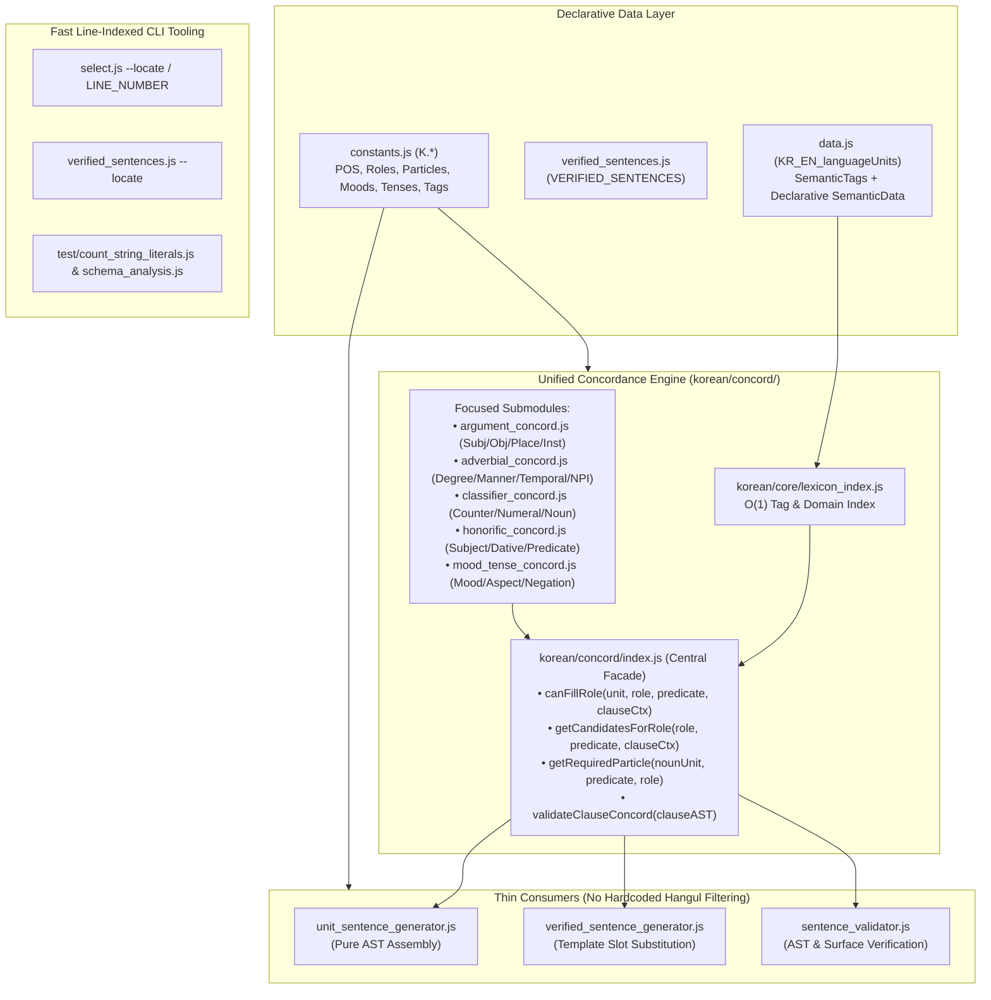

# Technical Debt & Centralized Concordance Refactoring Plan

## 1. Executive Assessment: Will This Improve Agent Token Efficiency?

**Yes — dramatically (estimated 60–75% reduction in tokens per QA fix cycle).**

During the recent Wave 1 (`Units 3–102`) and Wave 2 (`Units 103–250`) QA subagent passes, fixing flagged sentences required disproportionate token and tool-call overhead for four structural reasons:

1. **5-Way Split Brain for Collocation & Concordance**:
   When a subagent flags a bad sentence (e.g., `*눈이 자세히 옵니다` or `*방에 참석합니다`), an agent currently has to check and patch up to **five separate locations** that each implement overlapping subsets of Korean selectional restrictions:
   - `data.js` (`SemanticTags` + `260` stringified `/*js:filter*/` lambdas inside `SemanticData`)
   - `korean/specs/verb_argument_specs.js` (`ACTION_VERB_SPECS`, `DESCRIPTIVE_VERB_SPECS`)
   - `korean/core/morphology.js` (`getNounCandidatesForVerb`, `getSubjectCandidatesForDescriptiveVerb`, `filterWordsByTense`, `getVerbParticleType`)
   - `korean/concord/*.js` (`adverbial_concord.js`, `classifier_concord.js`, `spatial_concord.js`, `mood_concord.js`)
   - `korean/generation/unit_sentence_generator.js` (`3,674` lines) & `korean/generation/verified_sentence_generator.js` (`3,580` lines), which bypass or override `morphology.js` with hundreds of inline `[...].includes(ko)` patches.
2. **Hardcoded Hangul Arrays (`638` occurrences of `].includes(`)**:
   Instead of querying unit metadata (`hasTag(unit, ...)` or `SemanticData`), generator and concord files hardcode ad-hoc arrays of Hangul strings. When a new verb or noun in Wave 2/3/4 is audited, it is missing from those hardcoded arrays, causing agents to play whack-a-mole across multiple files.
3. **Line-Lookup Friction in Monoliths (`data.js` & `verified_sentences.js`)**:
   Because neither `select.js` nor `verified_sentences.js` outputs 1-based source line numbers, agents repeatedly spawn shell one-liners or read large line ranges just to locate the line number of a unit or template before calling `read_file` / `edit_file`.
4. **3,600-Line Generator Monoliths**:
   Reading context around `selectArgumentForActionVerb`, `Place AST`, `Time Noun AST`, or `isUnitEligibleForSlot` forces agents to load thousands of lines of interleaved AST-building and lexical-filtering code into their context window.

---

## 2. Quantitative Audit of Current Technical Debt

A static scan across `korean/`, `data.js`, `verified_sentences.js`, and `select.js` (`27,227` lines total) reveals the exact scale of the debt:

| File / Subsystem | Lines | `].includes(` | `=== "..."` / `!== "..."` | `/*js:filter*/` | `new Set([...])` |
| :--- | ---: | ---: | ---: | ---: | ---: |
| `korean/generation/unit_sentence_generator.js` | 3,674 | **256** | **296** | 0 | 11 |
| `korean/generation/verified_sentence_generator.js` | 3,580 | **13** | **369** | 0 | 6 |
| `data.js` | 2,356 | **260** | 56 | **260** | 0 |
| `select.js` | 1,975 | 1 | 119 | 1 | 0 |
| `korean/core/morphology.js` | 1,681 | **10** | **233** | 0 | 2 |
| `korean/generation/sentence_ast.js` | 1,100 | **49** | **111** | 0 | 0 |
| `korean/state.js` | 970 | 0 | 50 | 0 | 0 |
| `verified_sentences.js` | 738 | 1 | 6 | 0 | 0 |
| `korean/translation/natural_realizer.js` | 726 | 4 | 160 | 0 | 2 |
| `korean/ translation/literal_realizer.js` | 586 | 0 | 71 | 0 | 0 |
| `korean/core/stem_engine.js` | 470 | 5 | 83 | 0 | 0 |
| `korean/concord/classifier_concord.js` | 443 | **11** | 48 | 0 | 0 |
| `korean/generation/sentence_validator.js` | 374 | 3 | 39 | 0 | 0 |
| `korean/concord/adverbial_concord.js` | 302 | **20** | 50 | 0 | 0 |
| **Total Across Scanned Codebase** | **27,227** | **638** | **2,301** | **262** | **39** |

### Breakdown of `=== "..."` / `!== "..."` in `korean/` (`2,106` occurrences)
- **Hangul String Literals (`702` occurrences across `370` unique Hangul strings)**:
  Hardcoded vocabulary, stems, and particles (e.g., `"이"`, `"저"`, `"나"`, `"안"`, `"못"`, `"있다"`, `"이다"`, `"담다"`, `"넣다"`, `"자세히"`, `"천천히"`, `"방"`, `"교실"`).
- **ASCII Domain Magic Strings (`807` occurrences after excluding `typeof` checks)**:
  Un-constantized grammatical roles, tenses, speech levels, and AST node types:
  - Roles/Particles: `"subject"` (29), `"object"` (24), `"topic"` (20), `"dative"` (13), `"recipient"` (12), `"direction"` (8), `"copula"` (11), `"adnominal_modifier"` (13)
  - Tenses/Polarities/Moods: `"past"` (45), `"negative"` (26), `"future"` (22), `"interrogative"` (16), `"imperative"` (12), `"propositive"` (11)
  - Speech Levels & Deixis: `"formal_high"` (21), `"plain"` (13), `"spoken"` (8), `"medial"` (8), `"distal"` (8), `"AVst"` (8)

---

## 3. Additional Technical Debt Identified During Review

Beyond the four items noted in your prompt, four additional architectural issues are compounding cognitive load:

1. **260 Stringified JS Functions (`/*js:filter*/ (n, hasTag) => ...`) in `data.js`**:
   - `SemanticData.collocation_filter` currently stores raw JS arrow function code inside JSON strings, compiled via `new Function()` in [lexicon_index.js](file:///d:/Users/mvaga/Developer/agentic/antigravity/kongbuhey/korean/core/lexicon_index.js#L122-L146) and [filter_evaluator.js](file:///d:/Users/mvaga/Developer/agentic/antigravity/kongbuhey/korean/utils/filter_evaluator.js#L9-L41).
   - **260 of the 638 `].includes(` calls** live inside these stringified functions in `data.js` (e.g., `["손", "발", "얼굴", "귀", "입", ...].includes(n[1])`).
   - Because they are JS code inside JSON strings inside a JS array, they cannot be linted by standard AST tools, require regex scraping in `schema_analysis.js`, and frequently break when agents use `select.js` with shell quoting.
   - **Fix**: Replace stringified JS functions with a **declarative JSON filter object** in `SemanticData.collocation` (e.g., `{ anyTag: [...], allTags: [...], notTags: [...] }`), backed by proper `SemanticTags` on the target nouns.
2. **Triplicated Classifier Rules**:
   - Classifier-to-noun compatibility is defined in **three different ways** across [state.js](file:///d:/Users/mvaga/Developer/agentic/antigravity/kongbuhey/korean/state.js#L600-L675) (`CLASSIFIER_NOUN_SPECS`), [classifier_concord.js](file:///d:/Users/mvaga/Developer/agentic/antigravity/kongbuhey/korean/concord/classifier_concord.js#L99-L132) (hardcoded `if (ko === "살")`, `if (ko === "개")` with a 65-noun blocklist), and [sentence_validator.js](file:///d:/Users/mvaga/Developer/agentic/antigravity/kongbuhey/korean/generation/sentence_validator.js#L39-L51) (`CLASSIFIER_DOMAIN_RULES`).
3. **Divergent Slot Validation Between AST Generation and Verified Sentence Generation**:
   - [unit_sentence_generator.js](file:///d:/Users/mvaga/Developer/agentic/antigravity/kongbuhey/korean/generation/unit_sentence_generator.js) and [verified_sentence_generator.js](file:///d:/Users/mvaga/Developer/agentic/antigravity/kongbuhey/korean/generation/verified_sentence_generator.js) (`isUnitEligibleForSlot`) do not call a shared compatibility predicate. Fixing a collocation bug in `unit_sentence_generator.js` does not automatically protect slot substitution in `verified_sentence_generator.js`, or vice versa.
4. **`state.js` Global Mutable Singleton Coupling**:
   - [state.js](file:///d:/Users/mvaga/Developer/agentic/antigravity/kongbuhey/korean/state.js) maintains 45+ mutable `Set`/`Map` collections alongside `lexicon_index.js`. Consolidating lexical/semantic indexes into `lexicon_index.js` and concordance queries into `korean/concord/` removes redundant state initialization.

---

## 4. Proposed Architecture & Refactoring Design



### Pillar 1: Line-Number Lookup in `select.js` and `verified_sentences.js`

Give agents instant 1-based line numbers so they can use `read_file` and `edit_file` directly without scratch scripts or complex SQL updates:

1. **`select.js` Enhancements**:
   - **Virtual Column `Line` (`_line` / `line`)**: Available in any `SELECT` query:
     `node select.js "SELECT Line, Id, Korean, SemanticTags WHERE Id IN (146, 152, 1419)"`
   - **`--locate <id|ko|list>` Fast Flag**:
     `node select.js --locate 146,152,읽다`
     Outputs concise, clickable `file:line` references and the raw line preview:
     ```text
     data.js:201  [Id=146] 읽다 (Action Verb)
     data.js:207  [Id=152] 기다리다 (Action Verb)
     ```
2. **`verified_sentences.js` Enhancements**:
   - **`--locate <vs_id|unit_id|ko>` Fast Flag**:
     - `node verified_sentences.js --locate vs_316,vs_444` -> returns exact 1-based line numbers in `verified_sentences.js`.
     - `node verified_sentences.js --locate --unit 146` -> lists all `vs_*` templates containing Unit `146` along with their exact line numbers in `verified_sentences.js`.
   - Also include `[L<line>]` in the output of `node verified_sentences.js --find <query>` and `--list`.

### Pillar 2: Centralizing Language Unit Concordance (`korean/concord/`)

Create `korean/concord/index.js` as the **single source of truth** for all compatibility and candidate selection queries, backed by focused, pure-data submodules:

| Submodule | Responsibility | Replaces Scattered Logic In |
| :--- | :--- | :--- |
| `korean/concord/index.js` | Central facade: `canFillRole()`, `getCandidatesForRole()`, `getRequiredParticle()`, `validateClauseConcord()` | `morphology.js`, `unit_sentence_generator.js`, `verified_sentence_generator.js`, `sentence_validator.js` |
| `korean/concord/argument_concord.js` | Verb-Object, Verb-Subject, Adjective-Subject, Place-Action (`-에` static vs `-에서` dynamic vs `-에` destination), Spatial Position (`위/아래/안/밖` host compatibility), and Time-Action compatibility | `verb_argument_specs.js`, `morphology.js` (`getNounCandidatesForVerb`, `getSubjectCandidatesForDescriptiveVerb`), and ~1,400 lines of `unit_sentence_generator.js` |
| `korean/concord/adverbial_concord.js` | Degree, manner, temporal, frequency, and NPI adverb compatibility driven by `SemanticTags` (`punctual`, `durative`, `cognitive`, `gradable`, `npi`) instead of hardcoded Hangul arrays | Hardcoded arrays in `adverbial_concord.js` and `selectAdverbUnit` / `selectTimeUnit` in `unit_sentence_generator.js` |
| `korean/concord/classifier_concord.js` | Unified classifier-noun-numeral matrix (single table shared by generation, repair, and `sentence_validator.js`) | Duplicate tables in `state.js`, `classifier_concord.js`, and `sentence_validator.js` |
| `korean/concord/honorific_concord.js` | Elder/plain subject, dative recipient (`-께` vs `-에게`), and honorific/humble predicate concordance | Scattered checks in `morphology.js`, `unit_sentence_generator.js`, and `verified_sentence_generator.js` |
| `korean/concord/mood_tense_concord.js` | Imperative/propositive/volitional/tense/negation restrictions (e.g., 1st-person experiential adjectives, non-volitional verbs) | `mood_concord.js`, `clausal_validation.js`, and inline checks in `unit_sentence_generator.js` |

**Crucial Guarantee**: Both `unit_sentence_generator.js` (when building ASTs) and `verified_sentence_generator.js` (`isUnitEligibleForSlot` when substituting template slots) call `concord.canFillRole(candidateUnit, role, predicateUnit, context)`. Fixing a rule in `korean/concord/` fixes both generators and the validator simultaneously.

### Pillar 3: Eliminating Hardcoded Hangul Arrays (`].includes(` -> Unit Metadata)

Every hardcoded `[...].includes(ko)` array in `korean/` and `data.js` falls into one of two categories and will be migrated systematically:

1. **Intrinsic Lexical / Aspectual Properties of a Unit -> Encode in `SemanticTags` or `SemanticData` in `data.js`**:
   - *Aspectual classes on verbs* (replaces hardcoded lists in `adverbial_concord.js` and `Time Noun AST`):
     - `"punctual"` (`도착하다`, `출발하다`, `켜다`, `끄다`, `태어나다`, `죽다`, `합격하다`, `잃어버리다` — incompatible with `오래`, `천천히`, `계속`)
     - `"durative"` (`자다`, `쉬다`, `기다리다`, `살다`, `공부하다`, `일하다`)
     - `"placement_transitive"` (`놓다`, `올려놓다`, `넣다`, `담다`, `걸다`, `붙이다`, `꽂다` — requires both a locative `-에/에다가` and an accusative `-을/를` object)
     - `"posture_verb"` (`앉다`, `서다`, `눕다` — takes `-에` static location)
     - `"venue_attendance"` (`참석하다`, `결석하다`, `입학하다`, `졸업하다` — requires `"event"` or `"institution"`, never `"room"` like `방/화장실`)
   - *Experiential / Subcategorization properties on Descriptive Verbs*:
     - `"experiential_internal"` (`피곤하다`, `배고프다`, `목마르다`, `졸리다`, `섭섭하다`, `그립다` — requires 1st-person subject in declarative statements, 2nd-person in questions)
     - `"transient_state"` (`바쁘다`, `한가하다`, `춥다`, `덥다`, `시원하다`, `조용하다`, `시끄럽다` — compatible with temporal nouns like `오늘/요즘/주말`)
   - *Spatial / Container properties on Nouns*:
     - `"indoor_room"` (`방`, `교실`, `거실`, `부엌`, `화장실`, `사무실`) vs `"outdoor_ground"` (`운동장`, `마당`, `공원`, `길`) vs `"surface_furniture"` (`책상`, `식탁`, `의자`, `침대`, `선반`)
2. **Declarative Collocation Filters in `data.js`**:
   - Convert the 260 `/*js:filter*/` strings in `data.js` into declarative JSON filter specs (or pure `SemanticTags` where a tag already captures the set), e.g.:
     ```json
     "collocation": { "anyTag": ["clothing", "wearable"], "notTags": ["footwear", "headwear", "accessory"] }
     ```
   - Evaluated by a single 20-line pure function in `korean/concord/argument_concord.js` (no `new Function()`, no hardcoded Hangul arrays).

### Pillar 4: Eliminating Magic Strings (`=== "..."` -> `K.*` Constants or Unit Metadata)

1. **Expand `constants.js` (`K.*`) for Grammatical, AST, and Morphological Literals**:
   - Add concise constants to `constants.js` for all recurring ASCII and grammatical morpheme literals discovered by `test/count_string_literals.js --analyze`:
     - **AST Roles & Particle Types**: `K.ROLE_SUBJECT` (`"subject"`), `K.ROLE_TOPIC` (`"topic"`), `K.ROLE_OBJECT` (`"object"`), `K.ROLE_DATIVE` (`"dative"`), `K.ROLE_RECIPIENT` (`"recipient"`), `K.ROLE_DIRECTION` (`"direction"`), `K.ROLE_LOCATION_STATIC` (`"location_static"`), `K.ROLE_LOCATION_DYNAMIC` (`"location_dynamic"`), `K.ROLE_INSTRUMENTAL` (`"instrumental"`), `K.ROLE_COMITATIVE` (`"comitative"`), `K.ROLE_COPULA` (`"copula"`), `K.ROLE_ADNOMINAL` (`"adnominal_modifier"`).
     - **Tenses, Moods & Polarities**: `K.TENSE_PAST` (`"past"`), `K.TENSE_PRESENT` (`"present"`), `K.TENSE_FUTURE` (`"future"`), `K.POLARITY_NEGATIVE` (`"negative"`), `K.POLARITY_AFFIRMATIVE` (`"affirmative"`), `K.MOOD_INTERROGATIVE` (`"interrogative"`), `K.MOOD_IMPERATIVE` (`"imperative"`), `K.MOOD_PROPOSITIVE` (`"propositive"`), `K.MOOD_DECLARATIVE` (`"declarative"`).
     - **Speech Levels & Deixis**: `K.STYLE_FORMAL` (`"formal_high"`), `K.STYLE_POLITE` (`"polite"`), `K.STYLE_PLAIN` (`"plain"`), `K.STYLE_INTIMATE` (`"intimate"`), `K.DEIXIS_PROXIMAL` (`"proximal"`), `K.DEIXIS_MEDIAL` (`"medial"`), `K.DEIXIS_DISTAL` (`"distal"`).
   - Run `node test/count_string_literals.js --fix` across `korean/` and `select.js` to automatically replace bare strings with `K.*` constants, and keep `node test/count_string_literals.js` at `0 replacement opportunities` in `test.js`.
2. **Replace Hangul `=== "..."` Comparisons with Semantic Tag / `SemanticData` Checks**:
   - Instead of `if (ko === "안" || ko === "못")`, check `hasTag(unit, "short_negation")` (or `sd.negation_type`).
   - Instead of `if (ko === "이" || ko === "그" || ko === "저")`, check `hasTag(unit, "deictic_determiner")`.

---

## 5. Phased Execution Plan (Before Resuming QA Subagent Batches)

To keep the codebase 100% green at every step (`node test.js` passing all 7 stages), we should execute this refactoring in **4 focused phases** before resuming Wave 2–8 of `sentence_qa_subagent_batch_plan.md`:

### Phase 1: Line-Number Indexing in `select.js` & `verified_sentences.js` (Immediate Speedup)
- Add `--locate` and virtual column `Line` (`_line`) to `select.js`.
- Add `--locate` (by `vs_id`, `unit_id`, or substring) and line numbers in `--find` / `--list` to `verified_sentences.js`.
- Update `printHelp()` at the top of both files so any agent reading the first 100 lines immediately sees `--locate`.

### Phase 2: `constants.js` (`K.*`) Expansion & Automated Magic String Replacement
- Add the missing grammatical role, tense, mood, speech style, deixis, and slot category constants to `constants.js`.
- Use `node test/count_string_literals.js --fix` to replace ASCII magic strings across `korean/` and `select.js`.
- Verify `node test.js` and `node test/count_string_literals.js` pass.

### Phase 3: Centralized Concordance Engine (`korean/concord/`) & Vocabulary Tag Migration
- Encode the missing lexical/aspectual tags (`punctual`, `durative`, `placement_transitive`, `posture_verb`, `venue_attendance`, `experiential_internal`, `transient_state`, `indoor_room`, `surface_furniture`, etc.) onto units in `data.js`.
- Consolidate `classifier_concord.js`, `adverbial_concord.js`, `argument_concord.js`, `honorific_concord.js`, and `mood_tense_concord.js` under `korean/concord/index.js`.
- Migrate the `256` `].includes(` arrays out of `unit_sentence_generator.js`, the `20` out of `adverbial_concord.js`, and the `11` out of `classifier_concord.js` into declarative tag rules in `korean/concord/`.
- Wire `unit_sentence_generator.js`, `verified_sentence_generator.js` (`isUnitEligibleForSlot`), and `sentence_validator.js` to call `korean/concord/index.js`.

### Phase 4: Declarative `collocation` Schema in `data.js` (Eliminating `/*js:filter*/` Strings)
- Convert the `260` `/*js:filter*/` stringified functions in `data.js` into declarative JSON filter objects (`{ anyTag, allTags, notTags }`) after tagging any remaining lexical exceptions in `data.js`.
- Update `lexicon_index.js`, `select.js`, and `schema_analysis.js --audit-tags` to evaluate declarative filter objects directly without `new Function()`.

---

## 6. Open Decisions for Your Review

1. **Scope Before Resuming QA Subagents**:
   Would you like us to execute **all 4 phases** above before resuming `sentence_qa_subagent_batch_plan.md`, or start with **Phases 1–3** (Tooling `--locate`, `K.*` constants, and Centralizing `korean/concord/` + removing `].includes(` in `korean/`) and do **Phase 4** (`/*js:filter*/` migration in `data.js`) either now or alongside the remaining QA waves?
2. **`select.js` / `verified_sentences.js` CLI Flag Naming**:
   Does `node select.js --locate <id|ko>` (plus `SELECT Line, Id, Korean ...`) and `node verified_sentences.js --locate <vs_id|unit_id>` match how you and future agents would most naturally look up line numbers?
