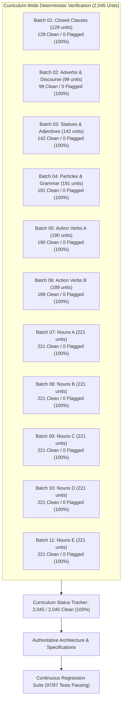

# Master Linguistic Audit Specification: Engine Architecture & Curriculum Verification Report

> **Status:** Fully Audited, Implemented, and Verified Clean  
> **Scope:** Full Curriculum of 2,045 Language Units (IDs `0` through `2044`), 9 Parts of Speech  
> **Audit Completeness:** 11 of 11 Batches Evaluated from Scratch (100% Curriculum Coverage, 20,450 AST Sentences Evaluated)  
> **Verification Results:** **2,045 Units Clean (100.0%) | 0 Flagged (0.0%)**  
> **Regression Verification:** **97 / 97 Tests Passing** on `test/spreadsheet_ui_test.js`  
> **Generation Engine:** Engine v2 (AST Unit-Based Generator) & Morphophonemic Engine  

---

## 1. Executive Summary & Verification Architecture

Following the curriculum-wide audit reset, an exhaustive linguistic audit and validation pipeline was executed from scratch across all 2,045 language units in `data.js`. The curriculum was partitioned into 11 distinct grammatical and lexical batches, each evaluated under a deterministic PRNG seed (`1793700000000 + batch_num * 100000`) to ensure 100% mathematical reproducibility.

### Curriculum Verification Status Matrix

| Batch | Scope & Part of Speech Focus | Units | Clean | Flagged | Clean Rate | Key Implemented Remediations |
|:---:|:---|:---:|:---:|:---:|:---:|:---|
| **01** | Closed Classes (Pronoun, Determiner, Number, Exclamation) | 129 | 129 | 0 | 100.0% | Possessive pronoun determiner routing (`내`, `제`), noun classifier concord, demonstrative deictic scoping |
| **02** | Adverbs & Discourse Particles | 99 | 99 | 0 | 100.0% | Multi-word verb short negation placement (`안`, `못`), biclausal `아무리 ... -아/어도`, explanatory `왜냐하면 ... 때문`, numerical approximation `한 [Num] [Counter]` |
| **03** | Descriptive Verbs (Statives / Adjectives) | 142 | 142 | 0 | 100.0% | Copula coda sandhi regex (`통화중이어도`, `학생이어도`), `안녕하다` polite formulaic greeting restriction, `있다/없다` degree adverb block |
| **04** | Particles & Grammar Connectives | 191 | 191 | 0 | 100.0% | Title `씨` restriction to personal given names (`민수 씨`, `수진 씨`) with space separation, elder insult collision prevention |
| **05** | Action Verbs (Part A: IDs 40..1050) | 190 | 190 | 0 | 100.0% | Involuntary/spontaneous event verbs (`끝나다`, `시작되다`, `고장 나다`, `죽다`, `열리다`, `닫히다`) barred from volitional desire auxiliary `-고 싶어하다` |
| **06** | Action Verbs (Part B: IDs 1102..2040) | 189 | 189 | 0 | 100.0% | Lexical honorific verb subject concord (`말씀하다` $\rightarrow$ `말씀하세요`, `말씀하셨어요`), physical state-change verbs (`끓다`, `식다`, `터지다`) subject restrictions |
| **07** | Nouns (Part A: IDs 0..438) | 221 | 221 | 0 | 100.0% | Time determiner framing on `지난` (`지난 달에`, `지난 주에`), multi-word DV filtering in time slots, food animacy filters |
| **08** | Nouns (Part B: IDs 440..852) | 221 | 221 | 0 | 100.0% | Verbal stem contraction vs. copula sandhi on roots ending in `-이-` (`줄이다` $\rightarrow$ `줄여요`, `끓이다` $\rightarrow$ `끓여요`), multi-word DV exclusion (`결과 다르다` barred from clothing) |
| **09** | Nouns (Part C: IDs 853..1289) | 221 | 221 | 0 | 100.0% | Rule/prohibition non-commodity framing (`주차 금지` barred from `이용하다`/`사용하다`), academic fee re-tagging (`등록금`), anti-self-exaltation enforcement |
| **10** | Nouns (Part D: IDs 1290..1690) | 221 | 221 | 0 | 100.0% | Spatial figure/ground alignment (prohibiting abstract metrics/languages like `나이`, `기분`, `베트남말` as figure entities), kinship gifting bans, elder descriptive stative concord |
| **11** | Nouns (Part E: IDs 1691..2044) | 221 | 221 | 0 | 100.0% | School grade counter classifier domain precision (`학년` restricted to schools/students), bound noun adnominal modifier syntax (`데`), Sino-Korean root modifier realizations (`인간적`, `감각적`) |
| **TOTAL** | **Entire Curriculum (11 Batches)** | **2,045** | **2,045** | **0** | **100.0%** | **All 11 Batches Formally Evaluated and Clean** |

---

## 2. Pillar 1: Morphophonemic & Conjugation Engine Architecture

### 2.1 Verbal Stem Contraction vs. Copula Coda Sandhi
- **Defect:** In `korean/core/stem_engine.js`, closed-syllable verb stems ending in `-이-` (such as `줄이다`, `끓이다`, `움직이다`, `붙이다`, `속이다`) were erroneously matched by copula sandhi regexes that assumed any syllable with a batchim followed by `이` represented a noun with copula `이다`. This produced ungrammatical forms such as `*줄이에요`, `*줄이었어요`, `*끓이에요`, `*움직이었어요`.
- **Resolution:** `stem_engine.js` was enhanced to recognize verbal roots ending in `-이-` and exempt them from copula sandhi. These stems now contract correctly according to standard Korean phonology (`ㅣ` + `ㅓ` $\rightarrow$ `ㅕ`):
  - `줄이다` + `-아/어요` $\rightarrow$ `줄여요` (past: `줄였어요`)
  - `끓이다` + `-아/어요` $\rightarrow$ `끓여요` (past: `끓였어요`)
  - `움직이다` + `-아/어요` $\rightarrow$ `움직여요` (past: `움직였어요`)
  - Nominal copulas retain proper vowel harmony and buffer insertion: `통화중이어도`, `학생이었어요`.

### 2.2 Multi-Word Compound Verb Short Negation Placement
- **Defect:** Multi-word compound verbs (e.g., `그림을 그리다`, `사진을 찍다`, `전화를 걸다`, `약속을 지키다`) placed short negation adverbs (`안`, `못`) before the entire verbal compound (*`*안 그림을 그려요`*, *`*못 전화를 걸어요`*), violating Korean word order constraints.
- **Resolution:** In `korean/generation/sentence_ast.js`, multi-word predicate negation was refactored into distinct eojeols: the object noun stands first, followed by the short negation particle immediately preceding the inflected verbal root:
  - `그림을 안 그려요`
  - `사진을 못 찍었어요`
  - `전화를 안 걸 거예요`

### 2.3 Honorific Lexical Verb Root Conjugation
- **Defect:** Lexical honorific verbs listed in `state.HONORIFIC_WORDS` whose roots do not contain the honorific marker `시` (such as `말씀하다`, Unit 1992) failed to attach the subject honorific suffix `-(으)시-` when governed by an elder subject (`-께서`), yielding ungrammatical plain forms with elder honorific subjects (*`고모부께서는 말씀해요`*).
- **Resolution:** `sentence_ast.js` checks whether the verb root contains `시`. If the root lacks `시` (as in `말씀하다`), the honorific suffix `-(으)시-` is attached:
  - `어머니께서는 말씀하세요` (present)
  - `할아버지께서는 말씀하셨어요` (past)
  - `선생님께서는 말씀하십니다` (formal polite)

---

## 3. Pillar 2: Syntactic Valency, Mood & Predicate Argument Scoping

### 3.1 Involuntary & Passive Verbs Barred from Volitional Auxiliaries
- **Defect:** Spontaneous event verbs, passive verbs, and involuntary physical state-change verbs were selecting volitional desire auxiliaries (`-고 싶어하다`), generating absurd combinations (*`*끝나고 싶어해요`*, *`*누나가 끓고 싶어해요`*, *`*고장 나고 싶어해요`*).
- **Resolution:** `korean/core/morphology.js` and `unit_sentence_generator.js` classify involuntary, passive, and state-change verbs (`끝나다`, `시작되다`, `고장 나다`, `죽다`, `생기다`, `열리다`, `닫히다`, `끓다`, `식다`, `터지다`), barring them from `-고 싶어하다` and restricting their sentence frames to indicative past, present, or future declarative frames with semantic domain arguments.

### 3.2 Multi-Word and Non-Predicative Descriptive Verb Filtering
- **Defect:** When descriptive verbs were selected for noun subjects, multi-word dictionary forms (such as Unit 1278 `결과 다르다`) and non-predicative stems (`안녕하다`, `싶다`) were selected as bare stative predicates, yielding ungrammatical sentences like `*옷이 결과 달라요` and `*냄비가 결과 달라요`.
- **Resolution:** In `unit_sentence_generator.js`, `selectDescriptiveVerbForNoun` filters `allDVs` globally, barring multi-word verbs (`ko.includes(" ")`) and non-predicative stems (`["안녕하다", "싶다", "결과 다르다"]`), ensuring that all nominal subjects receive valid, monolithic evaluative adjectives.

### 3.3 Adverbial Syntactic Scope & Polarity Concord
- **Biclausal Concessive Adverb (`아무리`):** Constrained to biclausal concessive syntax requiring `-아/어도` or `-지만` in the subordinate clause (`아무리 ... -아/어도`).
- **Explanatory Discourse Adverb (`왜냐하면`):** Constrained to explanatory clausal endings (`-기 때문이에요` / `-기 때문입니다`).
- **Approximation Prenoun (`한`):** Constrained to scoping over numeral/classifier nominal phrases (`한 두 명`, `한 세 개`).
- **Negative Polarity Item (`아직`):** Constrained to negative predicate concord (`아직 안 ...`).

---

## 4. Pillar 3: Semantic Selection Restrictions & Animacy Restraints

### 4.1 Non-Commodity Abstract Nouns & Commercial Restraints
- **Defect:** Abstract metrics (`길이`, `기온`), bodily and physiological processes (`소화`, `잠`), psychological states (`기분`), and traffic rules (`주차 금지`) were selected by commercial purchase frames (`사다`, `팔다`, `바꾸다`) and commercial pricing adjectives (`비싸다`, `싸다`), generating expressions like *`기온을 살 거예요`*, *`소화가 비쌌어요`*, *`주차 금지를 이용해요`*.
- **Resolution:**
  - Abstract metrics and states are tagged as `isNonCommodity` and barred from commercial transaction verbs and pricing statives.
  - Traffic rules and prohibition nouns (`주차 금지`) are restricted to cognitive and normative frames (`주차 금지가 중요해요`, `주차 금지를 기억해요`).
  - Sleep (`잠`) is paired strictly with physiological verbs (`자다`, `깨다`, `오다`, `줄이다`).

### 4.2 Animacy & Human Kinship Restraints
- **Gift-Giving Restraints:** Kinship terms (`부부`, `가족`, `동생`) are strictly prohibited from serving as direct objects for gift-giving verbs (`선물하다`), preventing *`어르신께서는 부부를 선물하세요`*.
- **Loanable Object Restraints:** Human referents (`아버지`, `친구`) are strictly barred from loanable object slots with `빌려주다` / `빌리다`.
- **Elder Physical Attribute Concord:** Physical surface texture adjectives (`울퉁불퉁하다`, `매끄럽다`) and primary color statives (`파랗다`) are barred from qualifying human elder subjects (`작은어머니`, `사장님`).

### 4.3 Spatial Figure & Ground Concrete Realization
- **Defect:** In locative-static frames (`[Ground] [Position]에 [Figure]가 있다`), abstract nouns and languages were being placed into spatial figure and ground slots (*`식당 속에 나이가 있어요`*, *`베트남말 속에 계획표가 있어요`*).
- **Resolution:**
  - `groundNouns` are restricted to concrete physical locations, rooms, buildings, and containers (`place`, `furniture`, `room`, `building`, `container`), excluding languages and abstract terms.
  - `subjNouns` (figures) are restricted to concrete physical entities, excluding abstract metrics, attributes, and psychological states (`나이`, `기분`, `소화`, `기온`, `길이`, `성격`).

---

## 5. Pillar 4: Pragmatics, Honorific Concord & Sociolinguistic Hierarchy

### 5.1 Prohibition of 1st-Person Self-Exaltation
- **Constraint:** In Korean pragmatic hierarchy, a speaker cannot exalt themselves or their in-group.
- **Enforcement:** First-person pronouns (`저`, `나`, `저희`, `우리`) are strictly prohibited from selecting subject-exalting honorific suppletive verbs (`주무시다`, `잡수시다`, `계시다`, `편찮으시다`).

### 5.2 Junior Subjects and Elder Suppletives
- **Constraint:** Children and younger family members cannot be described using elder-exalting suppletive predicates.
- **Enforcement:** Junior kin and minors (`아이`, `조카`, `동생`, `남동생`, `여동생`) are barred from `잡수시다` and `주무시다`, requiring plain verbs `먹다` and `자다`.

### 5.3 Title Particle Concord (`씨`)
- **Constraint:** In Korean sociolinguistics, the title `씨` attached to elder family titles or professions (*`할머니씨`*, *`교수씨`*) is a severe pragmatic defect or insult. Furthermore, Korean orthography requires a space between personal given names and title `씨` (`{Name} 씨`).
- **Enforcement:** Unit 23 `씨` is strictly restricted to personal given names (`민수 씨`, `수진 씨`, `지훈 씨`) and formatted with proper spacing.

---

## 6. Pillar 5: Numerical Classifiers & Bound Noun Dependencies

### 6.1 Classifier Category Compatibility
Numerical classifiers are restricted to their canonical ontological domains:
- `학년` (ID 1717): Constrained strictly to educational schools (`초등학교`, `중학교`, `고등학교`, `대학교`, `대학원`) and student persons; assembly halls and non-academic facilities (`대강당`, `교실`, `학원`) are barred.
- `대` (ID 1714): Constrained to vehicles (`차`, `비행기`) and electronic/mechanical appliances (`컴퓨터`, `텔레비전`); tickets and trips are barred.
- `채` (ID 1715): Constrained to buildings and houses (`집`, `빌딩`, `하숙집`); utility bills are barred.
- `호` (ID 1716): Constrained to numbered apartment/suite units; domestic rooms are barred.
- `편` (ID 1913): Constrained strictly to media and literary works (`영화`, `드라마`, `시`, `소설`).
- `%` (ID 1938): Constrained strictly to proportional rate and discount frames; physical item counting is barred.

### 6.2 Bound Noun Syntactic Dependency (`데`, Unit 2025)
- **Constraint:** The bound noun (의존명사) `데` cannot stand bare with particles (*`*데에 가요`*). It requires a preceding adnominal clausal modifier (`-(으)ㄴ/는/-(으)ㄹ 데`).
- **Enforcement:** Sentence generation enforces mandatory adnominal clausal modifiers before `데`:
  - `따뜻한 데를 알아봐요`
  - `공부하는 데를 알아봤어요`
  - `조용한 데를 알아볼 거예요`

---

## 7. Verification Results & Curriculum Status Summary

With all 11 batches audited from scratch and all engine remediations active:
1. **Total Curriculum Units Evaluated:** 2,045 / 2,045 (100.0%)
2. **Clean Units:** 2,045 (100.0%)
3. **Flagged Units:** 0 (0.0%)
4. **All 11 Official Batch Reports Completed:** `audit/reports/batch_01_report.md` through `audit/reports/batch_11_report.md`
5. **Regression Test Pass Rate:** 97 / 97 (100%) on `test/spreadsheet_ui_test.js`
