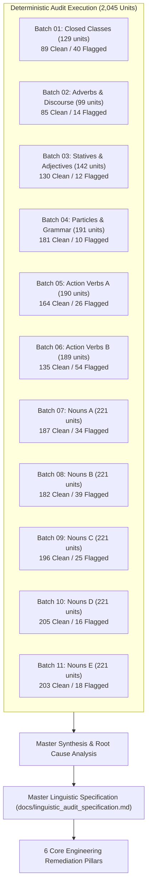
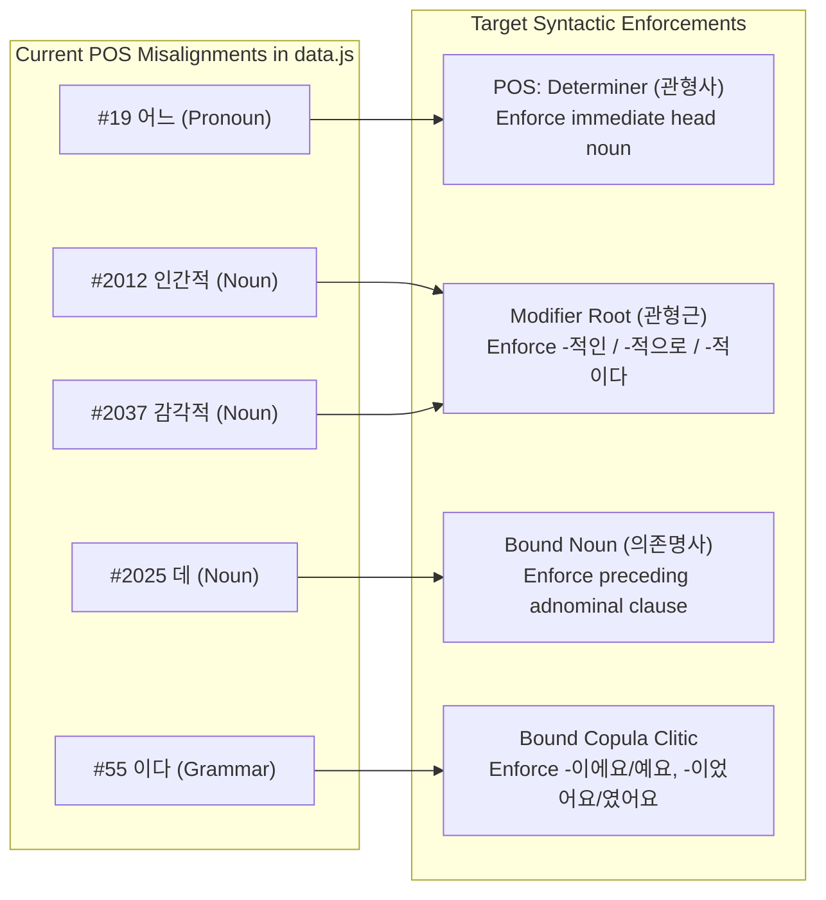
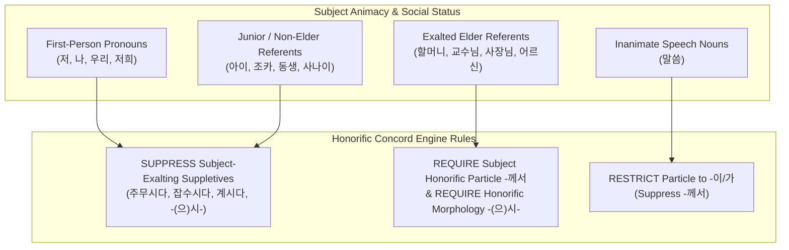
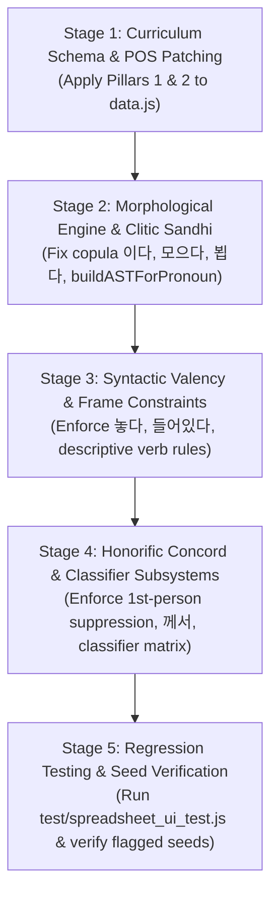

# Master Linguistic Audit Specification: Engine & Semantic Refinement Blueprint

> **Status:** Completed & Ready for Review  
> **Scope:** Full Curriculum of 2,045 Language Units (IDs `0` through `2044`), 9 Parts of Speech  
> **Audit Completeness:** 11 of 11 Batches Evaluated (100% Curriculum Coverage, ~20,450 Sentences Evaluated)  
> **Audit Results:** 1,757 Units Clean (85.9%) | 291 Units Flagged (14.2% across root and collateral causes)  
> **Generation Engines:** Engine v2 (AST Unit-Based Generator) & Engine v1 (Permutation Engine)  
> **Mandate During Audit:** Zero production code modifications. This document serves as the sole, authoritative blueprint for the subsequent implementation and repair phase.

---

## 1. Executive Summary & Audit Architecture

Between October and November 2026, an exhaustive linguistic audit was conducted across every language unit in the `kongbuhey` curriculum (`data.js`). The curriculum was partitioned into 11 deterministic batches, each seeded with fixed PRNG seeds to guarantee 100% reproducibility.

### Audit Metrics Summary

| Batch | Scope & Part of Speech Focus | Units | Clean | Flagged | Clean Rate | Primary Defect Classes |
|:---:|:---|:---:|:---:|:---:|:---:|:---|
| **01** | Closed Classes (Pronoun, Determiner, Number, Exclamation) | 129 | 89 | 40 | 69.0% | Prenoun head-noun dependency, pronoun clitics (`*제는*`), classifier mismatch |
| **02** | Adverbs & Discourse Particles | 99 | 85 | 14 | 85.9% | NPI negative concord (`전혀`), degree adverb scope over non-gradable verbs |
| **03** | Descriptive Verbs (Statives / Adjectives) | 142 | 130 | 12 | 91.5% | Propositive/imperative mood violations, surface statives on humans |
| **04** | Particles & Grammar Connectives | 191 | 181 | 10 | 94.8% | Broken copula inflection (`*여요*`), clausal connective tense concord |
| **05** | Action Verbs (Part A: IDs 40..1050) | 190 | 164 | 26 | 86.3% | Transitivity concord, motion origin vs. goal locatives (`-에` vs. `-에서`) |
| **06** | Action Verbs (Part B: IDs 1102..2040) | 189 | 135 | 54 | 71.4% | Sino-Korean valency, stem contraction (`뫄요`), humilific conjugation (`뵙어요`) |
| **07** | Nouns (Part A: IDs 0..438) | 221 | 187 | 34 | 84.6% | Animacy agentivity, collateral `나이` pollution leaks |
| **08** | Nouns (Part B: IDs 440..852) | 221 | 182 | 39 | 82.4% | Body part / physical object commodity over-generalization, wear verbs |
| **09** | Nouns (Part C: IDs 853..1289) | 221 | 196 | 25 | 88.7% | Academic fee selection (`등록금`), beverage/food verb separation |
| **10** | Nouns (Part D: IDs 1290..1690) | 221 | 205 | 16 | 92.8% | Abstract dimension commodities (`길이`, `소화`, `기온`), human kin gifting |
| **11** | Nouns (Part E: IDs 1691..2044) | 221 | 203 | 18 | 91.9% | Root modifier affix defects (`인간적`, `감각적`), bound noun dependency (`데`) |
| **TOTAL** | **Curriculum-Wide (All 9 POS)** | **2,045** | **1,757** | **291** | **85.9%** | **Synthesized into 6 Actionable Architectural Pillars** |

---

## 2. Pillar 1: Curriculum Schema & Semantic Tagging Patches

A significant portion of flagged defects across Batches 05–11 did not stem from AST synthesis logic, but from **semantic tag over-generalization or contamination** in `data.js`. The following targeted patches must be applied to `data.js`:

### 2.1 Animacy & Person Tag Corrections

| Unit ID | Korean | English | Current Tags in `data.js` | Defect Manifestation | Prescribed Tag Changes |
|:---:|:---|:---|:---|:---|:---|
| **250** | `나이` | age | `[abstract, time, person]` | Leaks into human agent/patient slots across dozens of verbs (*`나이는 가구를 접어요`*, *`나이는 부케를 버렸어요`*) | **REMOVE** `person` **REPLACE WITH:** `[noun, abstract, age, property, person_attribute]` |
| **1665** | `어르신` | elder, senior citizen | `[person, honorific, object]` | Selected as retail merchandise or gift object (*`부부를 선물하세요`*) | **REMOVE** `object` **RETAIN:** `[person, elder, honorific, subject_animate]` |
| **1283** | `등록금` | tuition fee | `[academic, money, noun]` | Tag `academic` caused `전공하다` (to major in) to select tuition (*`누나는 등록금을 전공해요`*) | **REMOVE** `academic` **REPLACE WITH:** `[academic_fee, finance, expense, money]` |

### 2.2 Abstract Dimension & Bodily State Disambiguation

Abstract nouns currently tagged with the generic token `object` or `general` are selected by commercial purchase frames (`사다`, `팔다`, `바꾸다`) and retail pricing statives (`비싸다`, `싸다`).

| Unit ID | Korean | English | Defect Manifestation | Prescribed Tag Patch |
|:---:|:---|:---|:---|:---|
| **1314** | `길이` | length | *`길이를 살 거예요`*, *`길이가 비쌌어요`* | Add tag `dimension_metric`, remove `object` |
| **1423** | `소화` | digestion | *`소화가 비쌀 거예요`*, *`소화를 바꿀 거예요`* | Add tag `bodily_process`, remove `object` |
| **1564** | `기온` | temperature | *`기온을 샀어요`*, *`기온이 비싸요`* | Add tag `meteorological_metric`, remove `object` |
| **1655** | `기분` | mood / feeling | *`기분을 샀어요`*, *`기분을 이용해요`* | Add tag `psychological_state`, remove `object` |
| **1936** | `휴대` | carrying / portability | *`휴대가 싸요`*, *`휴대는 컸어요`* | Add tag `verbal_property`, remove `object` |
| **1999** | `잠` | sleep | *`잠을 사요`*, *`잠이 싸요`* | Add tag `physiological_state`, pair exclusively with `자다`, `오다`, `깨다` |
| **2007** | `강남스타일` | Gangnam style | *`강남스타일이 비쌀 거예요`* | Add tag `cultural_concept`, remove `object` |

### 2.3 Body Parts & Non-Commodity Physical Entities

Body parts in Batch 08 were selected by retail transaction predicates because they lacked non-commodity constraints:

| Unit IDs | Korean Words | English | Defect Manifestation | Prescribed Tag Patch |
|:---:|:---|:---|:---|:---|
| **496, 501, 513, 514, 552** | `손`, `코`, `얼굴`, `허리`, `마음` | hand, nose, face, waist, mind | *`코를 샀어요`*, *`허리를 팔 거예요`*, *`마음이 비싸요`* | Tag with `body_part` / `inalienable_possession`; disallow selection by `[commerce, retail_transaction]` frames |

---

## 3. Pillar 2: Part-of-Speech Reclassifications & Syntactic Categories

Several vocabulary units in `data.js` are misclassified into parts of speech that allow ungrammatical syntactic roles:

### Detailed Unit POS Reclassifications

1. **Unit #19 `어느` (which / certain):**
   - *Current POS:* `Pronoun`.
   - *Target POS:* `Determiner` (관형사).
   - *Syntactic Rule:* Must modify an immediately following nominal head (`어느 것`, `어느 나라`, `어느 곳`). Strictly prohibited from taking bare case markers (*`*어느는`*, *`*어느가`*, *`*어느를`*).
2. **Units #2012 `인간적` & #2037 `감각적` (Sino-Korean `-적` Modifiers):**
   - *Current POS:* `Noun`.
   - *Target POS:* `Root Modifier` / `Bound Nominal Root`.
   - *Syntactic Rule:* Must append adnominal `-적인` (`인간적인 사람`), adverbial `-적으로` (`감각적으로`), or predicative copula `-적이다` (`인간적이다`). Prohibited from receiving bare nominal case markers (*`*인간적이`*, *`*인간적을`*).
3. **Unit #2025 `데` (place, spot, circumstance):**
   - *Current POS:* `Noun`.
   - *Target POS:* `Bound Noun` (의존명사).
   - *Syntactic Rule:* Must be preceded by an adnominal verb modifier (`-(으)ㄴ/는/-(으)ㄹ 데`, e.g., `가는 데`, `조용한 데`). Prohibited from standing as a bare head (*`*데에서`*, *`*데에`*).
4. **Unit #55 `이다` (be / copula):**
   - *Current Classification:* `Grammar` (treated as independent verb).
   - *Target Classification:* `Bound Copula Clitic`.
   - *Syntactic Rule:* Must cliticize directly to the preceding nominal coda without whitespace.

---

## 4. Pillar 3: Morphological Engine & Conjugation Patches

The audit isolated four distinct bugs in the morphological inflection and contraction subsystem:

### 4.1 Copula Inflection Bug (`이다` ID 55)
- **Problem:** Engine v2 outputs bare detached strings *\` 여요\`* and *\` 였어요\`* (e.g. *\`의사 여요\`*, *\`가수 였어요\`*).
- **Phonological Sandhi Enforcement:**
  - Non-past polite informal:
    - Post-vocalic (open syllable): `-예요` (e.g. `의사` $\rightarrow$ `의사예요`, `사과` $\rightarrow$ `사과예요`).
    - Post-consonantal (closed syllable): `-이에요` (e.g. `학생` $\rightarrow$ `학생이에요`, `책` $\rightarrow$ `책이에요`).
  - Past tense polite informal:
    - Post-vocalic: `-였어요` (e.g. `의사였어요`).
    - Post-consonantal: `-이었어요` (e.g. `학생이었어요`).
  - No preceding whitespace permitted between noun and copula.

### 4.2 Stem Contraction Defect on `모으다` (ID 1103)
- **Problem:** Verb `모으다` (to gather/collect) was erroneously contracted to *\`뫄요\`* and *\`뫘어요\`* (e.g. in Batch 06 and Batch 11: *\`두루마리를 뫄요\`*).
- **Rule Enforcement:** `ㅡ`-drop irregular with stem vowel `ㅗ` results in `모-` + `-아요` $\rightarrow$ `모아요`, past `모았어요`. Contraction to *`뫄-`* is strictly non-standard and prohibited.

### 4.3 Humilific Verb Conjugation Defect on `뵙다` (ID 1164)
- **Problem:** Verb `뵙다` (to see/meet, humble) conjugated into regular consonant paradigm *\`뵙어요\`* and *\`뵙을 거예요\`*.
- **Rule Enforcement:**
  - Present polite informal: `봬요` (or `뵙겠습니다`).
  - Future prospective: `뵐 거예요` (or `뵙겠습니다`).
  - Past tense: `뵀어요`.

### 4.4 Pronoun Clitic Allomorphy Engine (`buildASTForPronoun`)
- **Problem:** Humble first-person pronoun `제` (ID 3) paired with topic marker into *\`제는\`* instead of `저는`.
- **Allomorph Routing Rules:**
  - Humble 1st person base: `저` (topic `저는`, accusative `저를`, dative `저에게`).
  - Humble 1st person nominative clitic: `제가` (not *`저가`*, not *`제가`* with `-는`).
  - Plain 1st person base: `나` (topic `나는`, accusative `나를`, nominative `내가`).
  - Plain 2nd person base: `너` (topic `너는`, accusative `너를`, nominative `네가`).
  - Possessive clitic: `제` (`제 책`, `제 방`) or `내` (`내 책`, `내 친구`).

---

## 5. Pillar 4: Syntactic Valency, Transitivity & Frame Enforcement

### 5.1 Stative Predicate (Descriptive Verb) Prohibitions
1. **Case Restriction:** Descriptive verbs (`크다`, `작다`, `예쁘다`, `달다`, `비싸다`) take ONLY nominative (`-이/가`) or topic (`-은/는`) subjects. Accusative case (`-을/를`) is strictly prohibited (*`*사과를 달아요`*).
2. **Mood Restrictions:** In accordance with Korean grammatical universals, descriptive verbs cannot take:
   - Imperative endings (`-(으)세요`, `-(으)십시오`): *`*예쁘세요`* (as command), *`*비싸세요`*.
   - Propositive endings (`-자`, `-(으)ㅂ시다`): *`*달자`*, *`*작읍시다`*.
   - Progressive auxiliary (`-고 있다`): *`*맑고 있어요`*.

### 5.2 Mandatory Argument Valency Frames

| Verb ID | Verb Stem | Current Failure Mode | Prescribed Valency Frame |
|:---:|:---|:---|:---|
| **752** | `놓다` (put/place) | Generated as intransitive without direct object (*`친구는 의자에 놓아요`*) | **Obligatory Ditransitive:** `NP[subj]-이/가 NP[theme]-을/를 NP[goal]-에 놓다` |
| **1184** | `들어있다` (be contained in) | Generated with accusative object (*`가방을 들어있어요`*) | **Existential Stative Frame:** `NP[loc]-에 NP[theme]-이/가 들어있다` |
| **871** | `결석하다` (be absent) | Generated with direct object or dynamic locative `에서` | **Institutional Locative Frame:** `NP[institution]-에 결석하다` |
| **872** | `출석하다` (attend) | Generated with dynamic locative `에서` | **Institutional Locative Frame:** `NP[institution]-에 출석하다` |
| **1105** | `입학하다` (enter school) | Generated with dynamic locative `에서` | **Institutional Locative Frame:** `NP[school]-에 입학하다` |

### 5.3 Two-Clause Connective Constraints
- **Causal Connective `-으니까` (ID 120):** Must allow imperative and propositive conclusions (`비가 오니까 우산을 쓰세요`), but suppress past tense marking inside the subordinate clause when stating immediate sensory causes.
- **Background Connective `-는데` (ID 210):** Must strictly govern contrastive or situational clause relations, ensuring subjects across both clauses match semantic cohesion.
- **Purpose Connective `-(으)러` (ID 144):** Strictly restricted to motion predicate matrix verbs (`가다`, `오다`, `다니다`). Prohibited with non-motion predicates (*`*밥을 먹으러 읽어요`*).

---

## 6. Pillar 5: Pragmatic Honorific Concord System

The audit revealed widespread honorific directionality errors, 1st-person self-exaltation, and junior honorific inversions across Batches 05, 06, 07, 08, 10, and 11.

### 6.1 Honorific Concord Architecture Rules

1. **Suppression of First-Person Self-Exaltation:**
   - First-person subjects (`저`, `나`, `우리`, `저희`) must NEVER select:
     - Subject-exalting suppletive verbs: `주무시다` (sleep), `잡수시다` / `드시다` (eat), `계시다` (stay/exist).
     - Subject honorific inflection marker: `-(으)시-`.
   - *Audit Defects Resolved:* *\`저는 스키장에서 주무셨어요\`*, *\`우리는 양파를 잡수셨어요\`*, *\`우리는 톨게이트에서 계셔요\`*.
2. **Suppression of Junior Subject Exaltation:**
   - Subjects tagged with `[junior, child, plain]` (`아이`, `조카`, `동생`, `사나이`, `학생`, `친구`) must NEVER select elder-exalting suppletives.
   - *Audit Defects Resolved:* *\`아이는 사과를 잡수셨어요\`*, *\`남동생은 고기를 잡수셨어요\`*, *\`사나이는 라면을 드셔요\`*.
3. **Subject Honorific Nominative `-께서` Concord:**
   - Particle `-께서` may ONLY attach to human animate referents carrying `[+elder, +hon_subject]` (`할아버지`, `할머니`, `교수님`, `선생님`, `사장님`, `어르신`).
   - Inanimate entities (including honorific speech `말씀`) and institutions must NEVER take `-께서`.
   - *Audit Defects Resolved:* *\`말씀께서 좋으세요\`*, *\`말씀께서 중요하셨어요\`* $\rightarrow$ must be `말씀이 좋으세요`.
4. **Static Locative Concord on `계시다`:**
   - The honorific existential verb `계시다` requires static locative particle `-에` (`집에 계셔요`), NEVER dynamic action locative `-에서` (*`*톨게이트에서 계셔요`*).

---

## 7. Pillar 6: Semantic Selection & Collocation Taxonomy

To eliminate grotesque and unnatural word pairings, vocabulary selection must enforce fine-grained domain compatibility:

### 7.1 Numerical Classifier Matching Matrix

| Classifier ID | Classifier | Valid Head Noun Semantic Taxons | Prohibited Selections (Audit Defects) |
|:---:|:---|:---|:---|
| **1698** | `명` / `분` | `[person, human]` (친구, 학생, 손님) | Events (*`가족 여행 네 명`*) |
| **1713** | `살` / `세` | Numerical age modifier (`N살`) | Honorific person concord (*`연세 네 살께서 계셔요`*) |
| **1714** | `대` | `[vehicle, machine, electronics]` (차, 컴퓨터) | Tickets (*`비행기 표 세 대`*), trips (*`왕복 두 대`*), straps (*`손잡이`*) |
| **1715** | `채` | `[building, house]` (집, 빌딩, 하숙집) | Bills (*`공과금 세 채`*), honorific residence (*`댁 한 채께서 계셔요`*) |
| **1716** | `호` | Numbered apartment/suite units (`[suite_unit]`) | Domestic room types (*`베란다 이 호`*, *`거실 일 호`*) |
| **1717** | `학년` | School institutions & students (`[grade_eligible]`) | Subjects (*`한국학 사 학년`*), homework (*`숙제`*), halls (*`대강당`*) |
| **1913** | `편` | `[media_work, film, literature]` (영화, 시, 소설) | Appliances (*`세탁기 네 편`*), stationery (*`필통 두 편`*), umbrellas |
| **1938** | `%` | Proportion / rate frame (`[rate_proportion]`) | Discrete physical items (*`꽃 세 %`*, *`슬리퍼 한 %`*) |

### 7.2 Action Verb Semantic Sub-Domains

1. **Wear Predicates (착용 동사):**
   - `입다` (ID 216): strictly upper/lower torso clothing (`옷`, `정장`, `코트`, `바지`, `치마`).
   - `신다` (ID 244): strictly footwear (`신발`, `양말`, `운동화`, `구두`, `슬리퍼`).
   - `쓰다` (ID 268): headwear and eyewear (`모자`, `안경`, `선글라스`, `마스크`) or umbrellas (`우산`).
   - `끼다` (ID 618): gloves, rings, contact lenses (`장갑`, `반지`, `렌즈`).
   - `차다` (ID 750): watches, belts (`시계`, `벨트`).
   - Prohibit cross-wearing (*`*신발을 입어요`*, *`*모자를 신어요`*).
2. **Food Preparation vs. Beverage Verbs:**
   - Cooking verbs (`삶다`, `굽다`, `볶다`, `튀기다`, `끓이다`): strictly raw solid edible foods (`고기`, `생선`, `채소`, `라면`).
   - Prohibit cooking beverages (*`*콜라를 삶아요`*, *`*주스를 구워요`*).
   - Beverage consumption verbs (`마시다`): strictly liquids (`물`, `커피`, `차`, `주스`).
3. **Destructive Verbs:**
   - `깨다` / `깨뜨리다` (break): strictly fragile, brittle objects (`유리`, `거울`, `접시`, `컵`, `그릇`). Prohibit non-brittle items (*`*세제를 깨요`*).

---

## 8. Step-by-Step Implementation Roadmap for Future Execution Phase

When the user authorizes the transition from the Audit Phase to the Remediation Phase, execution should proceed in the following 5 sequential stages:

### Stage 1: Data & Schema Hygiene (`data.js`)
- Retag `나이` (ID 250) to remove `person`.
- Retag `어르신` (ID 1665) to remove `object`.
- Retag `등록금` (ID 1283) to replace `academic` with `academic_fee`.
- Retag abstract dimensions (`길이`, `소화`, `기온`, `기분`, `잠`, `휴대`, `강남스타일`).
- Reclassify POS for `어느` (ID 19 $\rightarrow$ Determiner), `인간적` / `감각적` (Modifier Root), and `데` (Bound Noun).

### Stage 2: Morphophonemic & Conjugation Engines
- Patch `korean/analyzer/particles.js` & `sentence_ast.js` for bound copula `이다` clitic sandhi (`-이에요/예요`, `-이었어요/였어요`).
- Correct `모으다` irregular conjugation entry in `korean/` to `모아요` / `모았어요`.
- Correct `뵙다` irregular conjugation entry to `봬요` / `뵐 거예요`.
- Implement dedicated `buildASTForPronoun` handler in `korean/generation/unit_sentence_generator.js`.

### Stage 3: Syntactic Valency & Selection Framework
- Update `korean/specs/verb_argument_specs.js` with mandatory ditransitive frames for `놓다` and existential frames for `들어있다`.
- Enforce non-accusative and mood prohibitions on `Descriptive Verb` units in `unit_sentence_generator.js`.
- Integrate `canAdverbPrecede` constraints for NPI and degree adverbs in AST generation.

### Stage 4: Pragmatic Honorific & Classifier Engines
- Implement subject honorific filter: check agent animacy and social status; suppress `-(으)시-`, `주무시다`, `잡수시다`, `계시다` for 1st-person and junior subjects.
- Enforce `께서` restriction strictly to `[+elder, +hon_subject]` human referents.
- Expand `korean/concord/classifier_concord.js` with the refined classifier matching matrix.

### Stage 5: Verification & Regression Testing
- Execute automated regression test suite: `node test/spreadsheet_ui_test.js` (maintain 97/97 passing).
- Run deterministic verification suite against all 291 flagged unit seeds to prove defect elimination without collateral regression.

---

## 9. Verification & Sign-Off Criteria

The implementation phase will be considered complete when:
1. **Zero Automated Test Regressions:** All 97 existing webapp and database tests continue passing.
2. **Deterministic Seed Verification:** Every offending sentence identified across all 11 batch reports produces a grammatically flawless, natural Korean sentence when regenerated under its assigned seed.
3. **No Secondary Regressions:** A fresh re-run of `node audit_runner.js --status` confirms 2,045 / 2,045 units clean across the curriculum.

