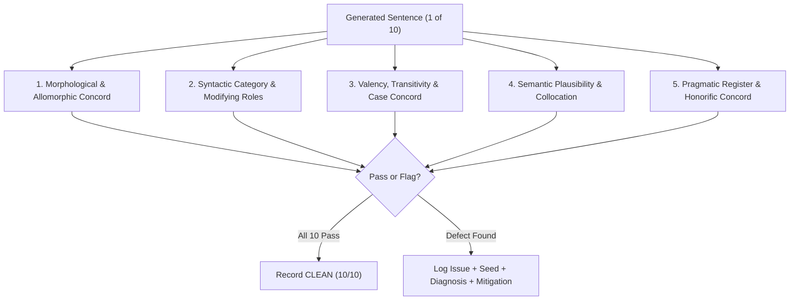
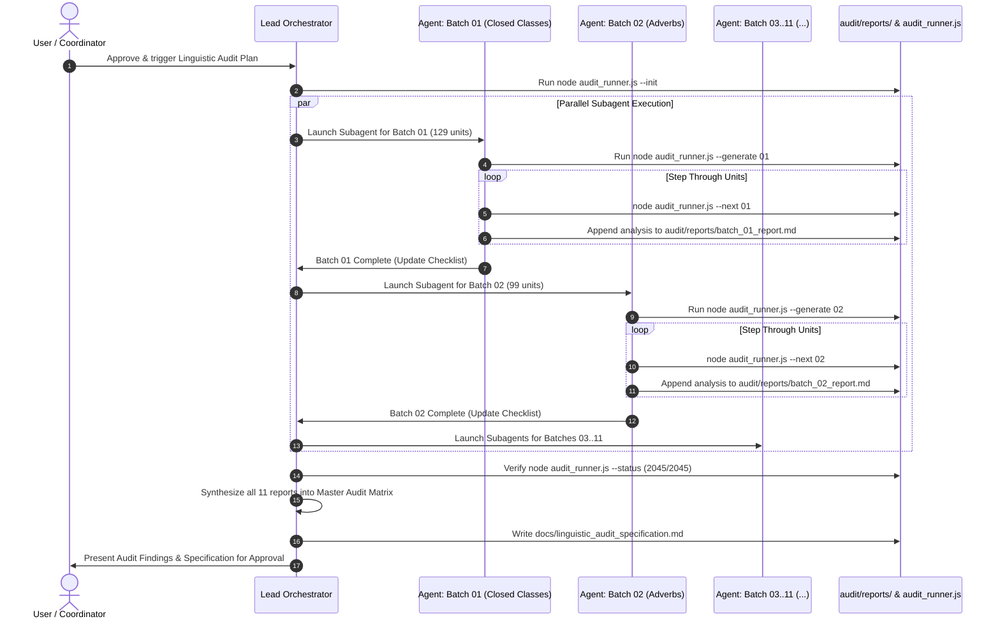

# Exhaustive Linguistic Audit Plan: Curriculum-Wide Sentence Quality & Semantic Refinement

> **Status:** Draft for Review  
> **Target Scope:** 2,045 Language Units (IDs `0` through `2044`), 9 Parts of Speech  
> **Generation Engine:** Engine v2 (AST Unit-Based Generator via `exhaustive.js` & `audit_runner.js`)  
> **Mandate:** **Linguistic Analysis & Specification ONLY (Zero Code Modifications)**  

---

## 1. Executive Summary & Objective

The Korean language generation system produces syntactically complex sentences through two integrated engines:
1. **Engine v2 (Unit-Based AST Generator):** Generates dual-translated sentences directly around target language units with semantic arguments and syntax frames.
2. **Engine v1 (Template Permutation Generator):** Expands grammar formulas against vocabulary slots.

While automated validation checks catch hard morphophonemic failures (e.g., coda sandhi, unresolved placeholders, literal transitivity crashes), subtle **linguistic unnaturalness**, **part-of-speech misalignments**, and **collocation mismatches** still occur. Examples include:
- **Prenoun/Determiner misuse:** `어느` (ID 19) is treated as a bare nominal subject (*`어느는 뭘 넣어요`*, *`어느가 날씬했어요`*) rather than a pre-nominal modifier requiring a head noun (*`어느 것`*, *`어느 길`*).
- **Pronoun / Clitic Allomorphy:** `제` (ID 3, "my" / humble "I") combines with topic marker `-는` into *`제는`* instead of humble topic *`저는`* or possessive noun phrase *`제 책`*.
- **Scalar / Gradability Mismatches:** Degree adverbs like `얼마나` modifying non-gradable dynamic actions (*`기자는 오후에 학생증을 얼마나 바꿀 거예요`*).

### Primary Objective
To systematically audit **all 2,045 language units** by generating 10 random sentences per unit (totaling ~20,450 sentences), conducting rigorous linguistic evaluations with a Korean-trained LLM, capturing reproducible PRNG seeds for every defect, identifying existing partial implementations in the codebase, and assembling a concrete specification for future engine and semantic tag improvements.

---

## 2. Core Linguistic Evaluation Rubric

Every generated sentence must be evaluated across five core linguistic dimensions:



### 1. Morphological & Allomorphic Concord (형태론적 및 이형태 호응)
- **Pronoun & Particle Sandhi:** Clitics must adapt to stem allomorphs (e.g., humble `저` + `가` $\rightarrow$ `제가`; `나` + `가` $\rightarrow$ `내가`; `너` + `가` $\rightarrow$ `네가`; `저` + `는` $\rightarrow$ `저는`, never `*제는`).
- **Phonological Alternation:** Valid coda/vocalic alternations for all particles (`-이/가`, `-을/를`, `-은/는`, `-과/와`, `-(으)로`, `-(으)면`, `-(이)라`).
- **Irregular Predicate Stems:** Correct stem transformations for `ㄷ`, `ㅂ`, `ㅅ`, `르`, `ㅎ`, `ㅡ` irregular verbs and adjectives.

### 2. Syntactic Category & Modifying Roles (통사적 범주 및 수식 호응)
- **Prenouns & Determiners (관형사):** Modifiers such as `어느`, `무슨`, `어떤`, `이/그/저` must modify an immediately adjacent head noun. They cannot stand alone as subjects, topics, or direct objects.
- **Classifiers & Numeral Counters:** Korean native vs. Sino-Korean numeral concord with bound counters (`한 명`, `두 개`, `세 살` vs. `일 학년`, `이 번`).
- **Bound Nouns (의존 명사):** Words like `것`, `수`, `줄`, `때`, `만큼` must be preceded by adnominal verb clauses (`-(으)ㄴ`, `-(으)ㄹ`, `-는`) or nominal modifiers.

### 3. Valency, Transitivity & Case Concord (논항 구조 및 격 호응)
- **Transitivity Restrictions:** Accusative case (`-을/를`) must only attach to arguments of transitive action verbs. Intransitive, stative, and motion verbs (`가다`, `오다`, `오르다`, `있다`) must take locative (`-에/에서`), directional (`-(으)로`), or nominative (`-이/가`) cases.
- **Descriptive Verb (Adjective) Prohibitions:** Descriptive verbs cannot take accusative objects (*`*사과를 달아요`*) or imperative/propositive mood endings (*`*달으세요`*, *`*달자`*).
- **Agent Animacy:** Inanimate non-agentive nouns cannot serve as volitional agents for human actions (e.g., *`*도장이 도서관을 방문해요`*).

### 4. Semantic Plausibility & Collocation Naturalness (의미적 타당성 및 연어성)
- **Predicate-Argument Plausibility:** Action verbs and direct objects must share plausible semantic selectional restrictions (e.g., consumption verbs select edible objects; clothing verbs select wearable items).
- **Adverbial Scope & Polarity:**
  - **Manner Adverbs** (`조용히`, `빨리`) modify action verbs, not pure descriptive verbs.
  - **Degree Adverbs** (`너무`, `매우`, `아주`, `얼마나`) modify gradable descriptive verbs or scalar action verbs.
  - **Negative Polarity Items (NPIs)** (`전혀`, `별로`, `결코`, `하나도`) strictly require negated predicates (`안`, `못`, `-지 않다`, `없다`).

### 5. Pragmatic Register & Honorific Concord (화용론적 및 높임 호응)
- **Subject Honorification:** Respect-worthy social entities (`선생님`, `부모님`, `할머니`) require honorific nominative `-께서` or honorific verbal markers `-(으)시-`.
- **Humble First-Person:** Humble pronouns (`저`, `저희`, `제`) must not co-occur with self-elevating honorific verbal morphology.

---

## 3. Work Breakdown Structure & Master Status Checklist

Because curriculum IDs in `data.js` are not strictly grouped by part of speech, batches are **partitioned by Part of Speech** and pre-populated into deterministic batch manifests (`audit/batches/batch_XX_*.json` and `audit/batches/batch_XX_ids.txt`) using `select.js` and `audit_runner.js`.

The curriculum of 2,045 units is partitioned into **11 Work Packages (Batches)**. Closed classes and predicates are audited first in dedicated POS batches, while the large Noun class (1,105 units) is partitioned into 5 equal batches of 221 units each.

### 3.1 Master Batch Table

| Batch | Category / Scope | POS Focus | Unit Count | Target Manifest / IDs | Primary Linguistic Focus | Status |
|:---:|:---|:---|:---:|:---|:---|:---:|
| **01** | Closed Modifiers & Deictics | `Pronoun` (36), `Determiner` (9), `Number` (66), `Exclamation` (18) | **129** | `audit/batches/batch_01_closed_classes.json` (IDs: 2..2018) | Prenoun head-noun requirements (`어느`), pronoun clitic allomorphy (`제/저`), counter classifier concord. | **COMPLETE** |
| **02** | Adverbs & Discourse | `Adverb` | **99** | `audit/batches/batch_02_adverbs.json` (IDs: 47..2039) | NPI polarity concord (`전혀`), degree vs. manner scope, clausal discourse placement. | **COMPLETE** |
| **03** | Statives & Adjectives | `Descriptive Verb` | **142** | `audit/batches/batch_03_descriptive_verbs.json` (IDs: 5..2043) | Non-accusative valency, mood restrictions (no imperative/propositive), gradability. | **COMPLETE** |
| **04** | Particles & Grammar | `Grammar` | **191** | `audit/batches/batch_04_grammar.json` (IDs: 23..1994) | Clause connectives (`-으니까`, `-는데`), tense concord, particle allomorphs, auxiliary verbs. | **COMPLETE** |
| **05** | Action Verbs (Part A) | `Action Verb` (1st Half) | **190** | `audit/batches/batch_05_action_verbs_part_a.json` (IDs: 40..1050) | Transitivity, accusative argument concord, motion goal/origin particles (`-에/에서/로`). | **COMPLETE** |
| **06** | Action Verbs (Part B) | `Action Verb` (2nd Half) | **189** | `audit/batches/batch_06_action_verbs_part_b.json` (IDs: 1102..2040) | Sino-Korean `-하다` compound verbs, abstract valency, instrument cases (`-(으)로`). | **COMPLETE** |
| **07** | Nouns (Part A) | `Noun` (1st Fifth) | **221** | `audit/batches/batch_07_nouns_part_a.json` (IDs: 0..438) | Animacy agentivity, people/family honorific concord, basic concrete nouns. | **COMPLETE** |
| **08** | Nouns (Part B) | `Noun` (2nd Fifth) | **221** | `audit/batches/batch_08_nouns_part_b.json` (IDs: 440..852) | Collocation with consumption/possession verbs, classifier matching (`개`, `마리`, `병`). | **COMPLETE** |
| **09** | Nouns (Part C) | `Noun` (3rd Fifth) | **221** | `audit/batches/batch_09_nouns_part_c.json` (IDs: 853..1289) | Action verb collocation, temporal noun particles (unmarked vs `-에`). | **COMPLETE** |
| **10** | Nouns (Part D) | `Noun` (4th Fifth) | **221** | `audit/batches/batch_10_nouns_part_d.json` (IDs: 1290..1690) | Abstract concepts, school/work nouns, directional/spatial noun concord. | **COMPLETE** |
| **11** | Nouns (Part E) | `Noun` (5th Fifth) | **221** | `audit/batches/batch_11_nouns_part_e.json` (IDs: 1691..2044) | Modern/tech vocabulary, loanwords, particle sandhi, recent additions. | **INCOMPLETE** |
| **TOTAL** | **Entire Curriculum** | **All 9 POS** | **2,045** | **11 Deterministic Manifests** | **100% Curriculum Coverage Verified** | **10 / 11 Complete** |

---

### 3.2 Subagent Execution Checklist

When subagents execute batches, they must update this checklist to record active progress and report locations:

- [x] **Stage 0: Batch Manifest Initialization** — Verified 2,045 units pre-populated in `audit/batches/`
- [x] **Batch 01 (Closed Modifiers & Deictics)** — [`audit/reports/batch_01_report.md`](file:///d:/Users/mvaga/Developer/agentic/antigravity/kongbuhey/audit/reports/batch_01_report.md) | Status: **COMPLETE** | Clean: 89, Flagged: 40
- [x] **Batch 02 (Adverbs & Discourse)** — [`audit/reports/batch_02_report.md`](file:///d:/Users/mvaga/Developer/agentic/antigravity/kongbuhey/audit/reports/batch_02_report.md) | Status: **COMPLETE** | Clean: 85, Flagged: 14
- [x] **Batch 03 (Statives & Adjectives)** — [`audit/reports/batch_03_report.md`](file:///d:/Users/mvaga/Developer/agentic/antigravity/kongbuhey/audit/reports/batch_03_report.md) | Status: **COMPLETE** | Clean: 130, Flagged: 12
- [x] **Batch 04 (Particles & Grammar)** — [`audit/reports/batch_04_report.md`](file:///d:/Users/mvaga/Developer/agentic/antigravity/kongbuhey/audit/reports/batch_04_report.md) | Status: **COMPLETE** | Clean: 181, Flagged: 10
- [x] **Batch 05 (Action Verbs Part A)** — [`audit/reports/batch_05_report.md`](file:///d:/Users/mvaga/Developer/agentic/antigravity/kongbuhey/audit/reports/batch_05_report.md) | Status: **COMPLETE** | Clean: 164, Flagged: 26
- [x] **Batch 06 (Action Verbs Part B)** — [`audit/reports/batch_06_report.md`](file:///d:/Users/mvaga/Developer/agentic/antigravity/kongbuhey/audit/reports/batch_06_report.md) | Status: **COMPLETE** | Clean: 135, Flagged: 54
- [x] **Batch 07 (Nouns Part A)** — [`audit/reports/batch_07_report.md`](file:///d:/Users/mvaga/Developer/agentic/antigravity/kongbuhey/audit/reports/batch_07_report.md) | Status: **COMPLETE** | Clean: 187, Flagged: 34
- [x] **Batch 08 (Nouns Part B)** — [`audit/reports/batch_08_report.md`](file:///d:/Users/mvaga/Developer/agentic/antigravity/kongbuhey/audit/reports/batch_08_report.md) | Status: **COMPLETE** | Clean: 182, Flagged: 39
- [x] **Batch 09 (Nouns Part C)** — [`audit/reports/batch_09_report.md`](file:///d:/Users/mvaga/Developer/agentic/antigravity/kongbuhey/audit/reports/batch_09_report.md) | Status: **COMPLETE** | Clean: 196, Flagged: 25
- [x] **Batch 10 (Nouns Part D)** — [`audit/reports/batch_10_report.md`](file:///d:/Users/mvaga/Developer/agentic/antigravity/kongbuhey/audit/reports/batch_10_report.md) | Status: **COMPLETE** | Clean: 205, Flagged: 16
- [ ] **Batch 11 (Nouns Part E)** — `audit/reports/batch_11_report.md` | Status: `INCOMPLETE` | Clean: 0, Flagged: 0
- [ ] **Stage 12: Master Synthesis & Specification** — `docs/linguistic_audit_specification.md` | Status: `INCOMPLETE`

---

## 4. Execution Tooling: `audit_runner.js` & `exhaustive.js`

To streamline auditing for both human engineers and autonomous LLM agents, the dedicated CLI helper [`audit_runner.js`](file:///d:/Users/mvaga/Developer/agentic/antigravity/kongbuhey/audit_runner.js) coordinates generation, per-unit step-through, and progress tracking.

### 4.1 CLI Commands

```bash
# 1. Initialize all 11 batch manifests in audit/batches/ (100% curriculum coverage check)
node audit_runner.js --init

# 2. Pre-generate all 10 sentences for each unit in a batch (written to scratch/audit/batch_XX/)
node audit_runner.js --generate 01

# 3. Step through the next unanalyzed unit in a batch (outputs sentences + copy/paste template)
node audit_runner.js --next 01

# 4. View curriculum-wide audit completion status and metrics
node audit_runner.js --status
```

### 4.2 How an Auditing Agent Uses the Tool
1. **Generate Sentences:** The agent runs `node audit_runner.js --generate <BATCH_ID>` to create all test sentences in `scratch/audit/batch_<BATCH_ID>_sentences.txt` and individual `unit_<ID>.txt` files.
2. **Review Next Unit:** The agent runs `node audit_runner.js --next <BATCH_ID>`. The tool inspects `audit/reports/batch_<BATCH_ID>_report.md` for already completed units, finds the first unanalyzed unit, prints its 10 sentences along with tags and reproduction seed, and outputs a ready-to-fill Markdown template.
3. **Analyze & Append:** The agent reviews the sentences against the 5-dimension rubric, fills in the diagnosis and mitigation (or marks `CLEAN`), and appends the entry to `audit/reports/batch_<BATCH_ID>_report.md`.
4. **Repeat:** Running `node audit_runner.js --next <BATCH_ID>` automatically advances to the next word until 100% of the batch is completed.
5. **Check Progress:** Running `node audit_runner.js --status` provides real-time tracking of units analyzed, clean passes, and flagged issues.

### 4.3 PRNG Seed & Reproducibility Formula
- Each batch uses a fixed deterministic seed formula: `1793700000000 + (BatchId * 100000)`.
- Individual unit sentences can also be re-verified directly via `exhaustive.js`:
  ```bash
  node exhaustive.js --id <ID> -eng none --ast -sentence 10 --seed <SEED> -o scratch/audit/unit_<ID>.txt
  ```
- **Every flagged issue in an audit note MUST record the exact `--seed` value.**

---

## 5. Standardized Audit Report Schema

All auditing agents must format entries in `audit/reports/batch_XX_report.md` using the uniform Markdown schema:

```markdown
### Unit #[ID] [Korean] ([POS]) - "[English]"
- **Status:** ISSUE_DETECTED | CLEAN
- **Reproducing Command:** `node exhaustive.js --id [ID] -eng none --ast -sentence 10 --seed [SEED] -o scratch/audit/unit_[ID].txt`
- **Generation Sample (Offending Variations):**
  - *Var [N]:* `[Full Korean Sentence]`
    - **Linguistic Error:** [Detailed explanation of why this sentence violates Korean grammar or natural idiom]
    - **Defect Category:** [Morphology / Valency / Prenoun Modifying / Collocation / Pragmatic Register]
- **Existing Codebase Footprint:**
  - [Identify relevant existing rules in `korean/concord/`, `korean/generation/`, or `korean/constants/tags.js`]
  - [Explain whether this is an unhandled case, a missing tag in data.js, or a bypassed concordance check]
- **Mitigation Opportunities:**
  - **Semantic Tag / Vector Proposal:** [e.g. `requires_noun_head`, `humble_pronoun`, `scalar_gradable`, `transitive_object:food`]
  - **Engine & Syntax Frame Adjustment:** [e.g. In `buildASTForNominal`, route humble possessive pronouns to noun-modifier slots rather than subject argument slots]
```

*For units where all 10 sentences pass cleanly:*
```markdown
### Unit #[ID] [Korean] ([POS]) - "[English]"
- **Status:** CLEAN
- **Reproducing Command:** `node exhaustive.js --id [ID] -eng none --ast -sentence 10 --seed [SEED] -o scratch/audit/unit_[ID].txt`
- **Linguistic Evaluation:** All 10 generated variations are grammatically sound and natural.
```

---

## 6. Codebase Cross-Reference Map (Existing Partial Implementations)

The generation and concordance system already contains extensive modular logic. Auditing agents must cross-reference their findings against these existing modules rather than reinventing the wheel:

```
korean/
├── constants/
│   ├── tags.js                  # Central registry of semantic tags (GRAMMAR_TAGS: degree, manner, npi, motion, etc.)
│   └── error_codes.js           # Standard error codes (VALENCY_TRANSITIVITY_MISMATCH, etc.)
├── concord/
│   ├── adverbial_concord.js     # Adverb classification (Degree, Manner, Discourse, NPIs) & placement rules
│   ├── classifier_concord.js    # Numeral counter mappings (CLASSIFIER_CONCORD_MAP)
│   ├── mood_concord.js          # Speech act constraints (Imperative, Propositive, Inability, Negative)
│   ├── spatial_concord.js       # Static locative vs. dynamic motion origin/goal concord
│   └── clausal_generator.js     # Two-clause connective structures
├── specs/
│   └── verb_argument_specs.js   # Hardcoded and inferred verb valency frames
├── generation/
│   ├── unit_sentence_generator.js # Core Engine v2 builders: buildASTForNominal, buildASTForActionVerb, etc.
│   ├── sentence_ast.js          # AST realizer and eojeol morpheme segmentation
│   └── sentence_validator.js    # Automated structural validation rules
└── analyzer/
    ├── particles.js             # Particle allomorph matching & sandhi logic
    └── token_analyzer.js        # Morpheme decomposition & contraction resolution
```

### Key Discovery Guidance for Agents:
1. **Pronoun vs. Determiner Misclassification:** Check if words currently tagged as `Pronoun` (e.g. `어느`, `이`, `그`, `저`) should be categorized as `Determiner` or receive `GRAMMAR_TAGS.DEMONSTRATIVE` / `PRENOUN` constraints.
2. **Adverbial Classifications:** Check if unflagged adverbs in `data.js` should be added to `state.DEGREE_ADVERBS`, `state.MANNER_ADVERBS`, or `state.ALL_NPI_WORDS` in `korean/state.js` or tagged in `korean/constants/tags.js`.
3. **Verb Valency Specs:** Check if an action verb exhibiting transitivity issues is present in `korean/specs/verb_argument_specs.js` or if it lacks the `transitive` / `intransitive` semantic tag in `data.js`.

---

## 7. Multi-Agent Orchestration Workflow



---

## 8. Final Deliverable: The Semantic & Engine Specification

Once all 2,045 units across the 11 batches have been audited, the findings will be organized into a comprehensive **Specification Document** (`docs/linguistic_audit_specification.md`) that will define:
1. **Curriculum Schema Updates:** Exact semantic tags to be appended to specific rows in `data.js`.
2. **Part-of-Speech Reclassifications:** Units requiring POS adjustment (e.g., `어느` $\rightarrow$ `Determiner`).
3. **Pronoun Allomorph Handling:** Dedicated `buildASTForPronoun` routing in `unit_sentence_generator.js` to handle humble forms (`저`, `제`), subject clitics (`제가`), and topic clitics (`저는`).
4. **Valency & Selectional Filtering:** Enhancements to `selectActionVerbForNoun` and `selectObjectNounForVerb` using semantic domain tags.
5. **Adverbial Scope Enforcement:** Active integration of `canAdverbPrecede` into Engine v2 AST generation.

> [!IMPORTANT]
> **No code or data modifications will be made until the user reviews and approves both this plan and the subsequent specification.**
